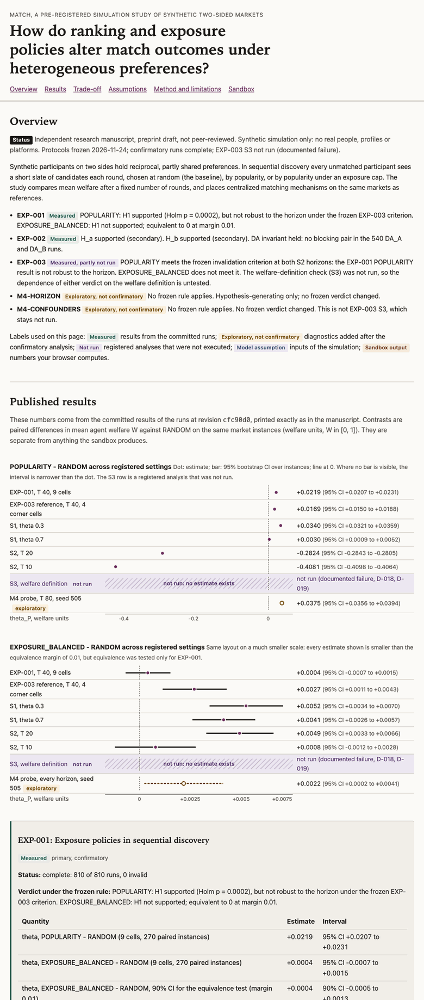

<!-- SPDX-License-Identifier: LicenseRef-MATCH-NC-Research-1.0 -->
# MATCH: matching algorithms and fairness

**Question.** How do ranking and exposure policies alter match outcomes under heterogeneous preferences?

**Status: M6 release candidate prepared, awaiting the owner's review (updated 2026-11-26).** The repository is public since 2026-11-25; no release, tag, DOI or preprint exists. The protocols were frozen by the owner on 2026-11-24 and the confirmatory experiments EXP-001 to EXP-003 were run (EXP-003 S3 not run, a documented failure). Experiment reports, the evidence audit, the integrated manuscript (`research/paper/manuscript.md`, independent research manuscript, preprint draft, not peer-reviewed) and an offline interactive page (`demo/`) exist. PDFs of the manuscript (`research/paper/manuscript.pdf`), the supplementary file and each experiment report are built locally with `python scripts/build_pdfs.py`. The owner approved the manuscript title and the funding, competing-interest and AI-use statements on 2026-11-25; the owner's full-text review of the manuscript and the review checklist (`research/publication/author_review.md`) are pending. All results are synthetic simulations. The repository has been public at https://github.com/mohamedbechirkefi/match-fairness-exposure since 2026-11-25; the interactive page is hosted at https://match-fairness-exposure.kefimohamedbechir.workers.dev. Author: Mohamed Bechir Kefi, independent researcher.



## Experiments

| Experiment | Role | Status | Result under the frozen rule |
|---|---|---|---|
| EXP-001 | primary, confirmatory | complete, 810 of 810 runs | POPULARITY - RANDOM +0.0219 (95% CI +0.0207 to +0.0231), H1 supported but not robust to the horizon; EXPOSURE_BALANCED - RANDOM +0.0004, equivalent to 0 at margin 0.01 |
| EXP-002 | secondary | complete, 810 of 810 runs | DA_A - RANDOM +0.0963 (95% CI +0.0954 to +0.0973); MAXW - DA_A blocking pairs per 100 agents +231.06 (95% CI +226.32 to +235.70) |
| EXP-003 | sensitivity | partial: S1 and S2 complete; **S3 not run** (documented failure) | POPULARITY reverses at T 10 (-0.4081) and T 20 (-0.2824): not robust; EXPOSURE_BALANCED not invalidated; welfare-definition dependence untested |

Reports: `research/experiments/EXP-00N/report.md`. Exploratory M4 diagnostics are labelled as such in the manuscript, section 5.4.

## Why it matters

Platforms that help people find partners or counterparts decide who sees whom. That exposure choice can change who gets matched, how good matches are, and how unequally attention is spread. MATCH studies this question in fully synthetic markets, where every assumption is explicit and every run is reproducible.

## Design

- Synthetic two-sided markets with reciprocal preferences, varying side imbalance and preference correlation.
- Sequential discovery with three slate policies: random exposure (baseline), popularity ranking, exposure-balanced ranking.
- Centralized references: deferred acceptance (both sides proposing) and a utilitarian assignment.
- Metrics: mean agent welfare (primary), unmatched fraction, mutual satisfaction, exposure inequality, blocking pairs, subgroup outcomes.
- A static interactive page and a formal manuscript with one report per experiment.

See `research/protocol.md` and `research/experiment_registry.csv` (EXP-001 to EXP-003).

## What is implemented

- Package `match_lab` (see `src/README.md`): market generator, the three slate policies, deferred acceptance, utilitarian assignment, all protocol metrics, uncertainty machinery, versioned result and manifest schemas, run manifests, report generator (Markdown, CSV, SVG, PDF through pandoc and Typst).
- CLI: `python -m match_lab {smoke,run,report,test}`.
- Test suite (`tests/README.md`), including Gale and Shapley stability on hand-computed examples and brute-force differential tests.
- Interactive page (`demo/`, TypeScript, React and Vite, static and offline): published results with intervals, a fairness and satisfaction trade-off chart, and a sandbox that runs a port of the engine in a Web Worker (see `demo/README.md`).

## Quick start (development)

```
uv sync --frozen
uv run --frozen pytest -q
uv run --frozen python -m match_lab smoke   # exploratory
```

`uv` is any uv installation; in the development workspace it is the shared copy in `.tools/py/bin/` next to this repository. PDFs are built with `python scripts/build_pdfs.py` (pandoc and the `typst` Python package; set `MATCH_PANDOC` and `MATCH_TYPST_PYTHON` if they are not in the workspace's `.tools/`).

## Interactive page (quick start)

```
cd demo && npm ci && npm run build && npm run preview
```

The page reads `demo/public/data/results.json`, written by `python scripts/export_demo_data.py` from committed results only; `tests/test_demo_export.py` checks that every number it shows is printed in the manuscript.

## Data

No external data. All data are synthetic, generated from code, parameters and seeds (`data/manifest.json`). Public datasets examined and excluded are listed in `research/literature_review.md`.

## Limitations

Synthetic agents only; no claim about real people or any real platform. See `research/limitations.md`.

## Licence

Source-available, non-commercial research licence: MATCH Source-Available Non-Commercial Research License v1.0 (`LICENSE`, `NOTICE.md`). It is not an OSI-approved open-source licence. Contributions require the CLA (`CLA.md`, `CONTRIBUTING.md`).

## Citation

See `CITATION.cff`.
