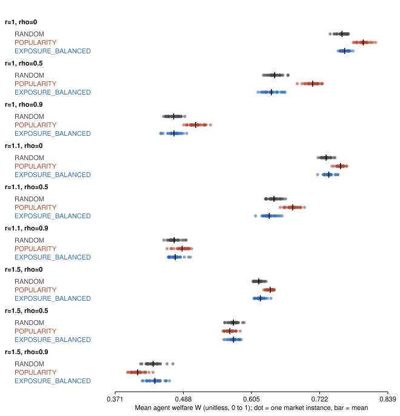
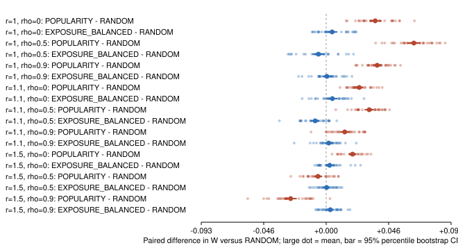

<!-- SPDX-License-Identifier: LicenseRef-MATCH-NC-Research-1.0 -->
# EXP-001 report: exposure policies in sequential discovery

## 1. Identification

| Item | Value |
|---|---|
| Experiment | EXP-001, primary (confirmatory) |
| Date of run | 2026-11-24 (UTC 23:33:51 to 23:38:08); report written 2026-11-25 |
| Report version | 1.1 (M4: exploratory addendum in section 9; no frozen result changed) |
| Status | Complete: full frozen matrix, 810 of 810 runs, 0 invalid, 0 excluded. Robustness: not robust to the horizon (EXP-003 S2) |
| Author | Mohamed Bechir Kefi (no affiliation). AI assistance: Claude (Anthropic) ran the frozen commands and drafted this report as a research and development assistant; it is not an author. |
| Protocol | `research/experiments/EXP-001/protocol.md` v1.0, SHA-256 `0d64280b9e2dcb0a3f17bf056eaf3cadf5f5a009efa88d6eed99ad05eafb3c2c`; main protocol `research/protocol.md` SHA-256 `81f24e9e4bc15434837208705f61619d6415bd1643985142248c926482e160c5` (freeze record `research/freeze.json`) |
| Config | `experiments/configs/EXP-001.json`, file SHA-256 `cb65e283c7d35d342e76abb9221e400a43b7603be2d1f4a510158f25531467e5`, canonical SHA-256 `5e747575d51c0b0253ffcc20ca22fdb1e0f3770c7421f1546f7ff8ebc93df422` |
| Provenance revision | `cfc90d0dfa9aa9058ee780a8d8fe3abdc77343d3` (clean tree) |

All agents are synthetic. Nothing in this report describes real people, real platforms or any proprietary ranking system. All numbers are copied (rounded to the precision shown) from the committed files named in each section; nothing was recomputed for this report.

## 2. Executive summary

**Question.** In synthetic two-sided markets with reciprocal preferences, does the slate policy used during sequential discovery (POPULARITY or EXPOSURE_BALANCED, versus RANDOM) change mean agent welfare W after T = 40 rounds?

**Method.** 270 synthetic market instances (9 cells of imbalance r by preference correlation rho, 30 instances each, n_A = 200), each run under all three policies with common random numbers. Estimand theta_P: the equal-weight mean over cells of the paired difference W_P - W_RANDOM. Stratified bootstrap CIs, stratified sign-flip test (10,000 draws), Holm correction over the two contrasts.

**Outcome.** POPULARITY raised W relative to RANDOM: theta = +0.0219 (95% CI +0.0207 to +0.0231; Holm-adjusted p = 0.0002). H1 is supported for POPULARITY. EXPOSURE_BALANCED did not differ detectably: theta = +0.0004 (95% CI -0.0007 to +0.0015; Holm-adjusted p = 0.51). H1 is not supported for it; its 90% CI (-0.0005 to +0.0013) lies inside the pre-registered equivalence margin of plus or minus 0.01, so under the frozen rule its effect is equivalent to zero at that margin.

**Principal caveat.** Under the frozen EXP-003 criterion the POPULARITY result is not robust: on the corner cells its sign reverses at T = 10 and T = 20, so the T = 40 gain reflects how fast matches form within the horizon rather than a horizon-free effect. Its sign also varies across cells: it is negative in the cells r = 1.5 with rho = 0.5 and 0.9. The metric-definition check (EXP-003 S3) was not run (owner decision, D-019).

## 3. Rationale and literature

Popularity ranking concentrates exposure on candidates many viewers like; under correlated preferences those candidates are also in demand and can match only once. Exposure balancing spreads attention. Exposure as the quantity a ranking allocates is analysed by Singh and Joachims (2018; DOI 10.1145/3219819.3220088; full text opened on 2026-11-25, claim checked against the abstract and section 1). Su, Bayoumi and Joachims (2021; arXiv:2106.01941; preprint; full text opened on 2026-11-25, claim checked against the abstract and section 4) argue that ranking by one-sided relevance is suboptimal in matching markets with capacity limits. Ashlagi, Kanoria and Leshno (2017; DOI 10.1086/689869; full text opened on 2026-11-25, claim checked against the abstract, p. 69) show that small imbalance strongly favours the short side under random preferences, which motivates varying r. The gap addressed is narrow: a paired, pre-registered comparison of three simple, interpretable slate policies on the same synthetic markets across imbalance and correlation. No novelty is claimed. Sources and verification levels: `research/literature_review.md`.

## 4. Hypotheses and operational definitions

- Model (`research/protocol.md` section 2): u_ij = sqrt(rho) q_j + sqrt(1 - rho) e_ij; satisfaction s_ij = 1 - (rank_i(j) - 1) / (m_i - 1); j acceptable to i iff u_ij >= the theta-quantile of i's utilities (theta = 0.5); slates of k = 5; T = 40 rounds; capacity one; unmatched satisfaction 0.
- Primary metric: W = (1 / (n_A + n_B)) sum over agents x of s_x, unitless in [0, 1], higher is better.
- For P in {POPULARITY, EXPOSURE_BALANCED}: D_P(m) = W_P(m) - W_RANDOM(m); theta_P = (1/9) sum over cells of E[D_P | cell].
- H0_P: theta_P = 0; H1_P: theta_P != 0 (nondirectional). Holm over the two contrasts, familywise alpha 0.05.
- Disconfirmation: a Holm-adjusted p >= 0.05 means H1_P is not supported. Equivalence is claimed only if the 90% CI of theta_P lies inside (-0.01, +0.01).
- Controls: RANDOM is the baseline; common random numbers; identical thresholds, horizon and viewer order across arms. POPULARITY and EXPOSURE_BALANCED break score ties with one shared random key per round (amendment F2).

## 5. Methodology

- **Algorithms.** RANDOM: uniform slate from eligible candidates. POPULARITY: candidates sorted by smoothed like rate (L_j + 1) / (e_j + 2), ties by a per-round shared random key. EXPOSURE_BALANCED: same score, with a per-round exposure cap c = ceil((1 + delta) k V / C), delta = 0.5. Mutual likes are resolved greedily at the end of each round by s_ij + s_ji. Code: `src/match_lab/sequential.py`, `market.py`, `metrics.py`, `stats.py`, `report.py`.
- **Data provenance.** Synthetic only, regenerated in memory from the seed (`data/manifest.json`, SHA-256 `506b2c412984c7a41c436b889c159c5a139744c4a1ccdf7396a7a88427f216cf`). No external data and no licence question.
- **Design.** r in {1.0, 1.1, 1.5}; rho in {0.0, 0.5, 0.9}; 30 instances per cell; 3 arms; 810 runs. Root seed 20261124; instance seed `SeedSequence(entropy=20261124, spawn_key=(round(1000 r), round(1000 rho), instance))`.
- **Hardware and software.** Apple M1 Pro, macOS 15.3.1 (arm64), Python 3.12.1, numpy 2.3.5, scipy 1.16.3, match_lab 0.2.0 (`results/confirmatory/EXP-001/run_manifest.json`). One process under `nice -n 10`, concurrent with the EXP-002 process and other sessions on a shared machine.
- **Budget.** 30 minutes wall clock (amendment F4); used 255.2 s.
- **Statistical plan (as frozen).** Per-cell paired mean differences with 95% percentile bootstrap CIs (10,000 resamples); theta_P with stratified bootstrap CIs (95% and 90%); stratified paired sign-flip test (10,000 draws, fixed report seed); Holm; effect sizes as mean difference and dz.

## 6. Implementation verification

- Test suite before the run: 103 passed, 0 failed (`.venv/bin/python -m pytest -q`), covering hand-computed Gale and Shapley examples, metric values on hand-computed markets, DA zero blocking pairs against brute-force enumeration, MAXW against brute force, determinism and the freeze guard.
- Exploratory smoke before the run (journal J-0009, exploratory root seed 101): 120 runs, 0 invalid, metric values identical to the M2 smoke run; an independent naive recomputation of W, U, M and blocking pairs agreed exactly with the stored metrics on 8 runs.
- In-run checks: every run passed the validity checks (no duplicate match, capacity one, finite metrics in range, schema validation at export and import); the first instance of each (cell, arm) was re-run under tracemalloc and reproduced its metrics.
- Faithfulness: the implementation follows protocol section 2.2 as frozen, including the shared tie key. The degenerate-case checks of the generated report show the exposure cap shortened between 0.0% and 1.0% of EXPOSURE_BALANCED slates per cell (`results/confirmatory/EXP-001/report/report.md`).

## 7. Execution record

- Command: `nice -n 10 .venv/bin/python -m match_lab run --config experiments/configs/EXP-001.json` (the protocol's `uv run --frozen python -m match_lab run ...` in the same locked environment, synced with `uv sync --frozen --all-groups --all-extras`). Exit status 0. Log: `results/confirmatory/logs/EXP-001.log`.
- Start 2026-11-24T23:33:51Z, end 23:38:08Z; wall clock 255.2 s (manifest).
- Runs: 810 planned, 810 executed, 0 invalid, 0 excluded, none dropped, no retry. Run ids `EXP-001/r{r}-rho{rho}-i{000..029}-base/{arm}`, listed with spawn keys and runtimes in `results/confirmatory/EXP-001/run_manifest.json`.
- Tables and figures: `nice -n 10 .venv/bin/python -m match_lab report --results results/confirmatory/EXP-001/results.json --out results/confirmatory/EXP-001/report`.
- **Deviations from the frozen protocol: none** in design, data, seeds, config or analysis plan. Disclosed:
  1. The provenance revision is `cfc90d0`, not the frozen-content revision `88f3438`. In between, only records, the EXP-002/EXP-003 analysis module, the CLI, tests and the restriction of p-values to EXP-001 (protocol section 8) were added, all committed before any confirmatory output existed (D-017). No simulation, metric or statistics code changed, and the frozen hashes still match.
  2. Exploratory values of this contrast were seen before the freeze (C4 disclosure in `research/freeze.json`). An unscheduled execution of this config in the freeze session was deleted unread (J-0007, J-0008).
  3. Owner decisions of 2026-11-25 ("approve all recommendations, RIGGED A"): EXP-003 S3 is recorded as not run, a documented failure (D-019), and this report was written after the runs from committed results only (D-020).

## 8. Results

### 8.1 Primary contrasts (confirmatory)

Source: `results/confirmatory/EXP-001/report/tables/EXP-001_pooled_W.csv`.

| Contrast | theta_P | 95% CI | 90% CI | p (sign-flip) | p (Holm) | Decision |
|---|---|---|---|---|---|---|
| POP - RND | +0.0219 | +0.0207 to +0.0231 | +0.0209 to +0.0229 | 0.0001 | 0.0002 | H1 supported |
| EXB - RND | +0.0004 | -0.0007 to +0.0015 | -0.0005 to +0.0013 | 0.5137 | 0.5137 | H1 not supported; equivalent to 0 at margin 0.01 |

RND = RANDOM, POP = POPULARITY, EXB = EXPOSURE_BALANCED. Independent sample size: 270 market instances (30 per cell), paired across arms. The POPULARITY sign-flip p-value (0.0001) is the smallest value a 10,000-draw test can return, so the true p-value may be smaller.

### 8.2 Per-cell paired differences (secondary, unadjusted)

Source: `results/confirmatory/EXP-001/report/tables/EXP-001_paired_differences_W.csv`.

| r, rho | POP - RND | 95% CI | dz | EXB - RND | 95% CI | dz |
|---|---|---|---|---|---|---|
| 1.0, 0.0 | +0.0365 | +0.0323 to +0.0410 | 2.98 | +0.0045 | +0.0007 to +0.0083 | 0.42 |
| 1.0, 0.5 | +0.0652 | +0.0603 to +0.0699 | 4.77 | -0.0057 | -0.0101 to -0.0013 | -0.45 |
| 1.0, 0.9 | +0.0379 | +0.0348 to +0.0410 | 4.39 | +0.0006 | -0.0027 to +0.0038 | 0.06 |
| 1.1, 0.0 | +0.0246 | +0.0219 to +0.0274 | 3.17 | +0.0046 | +0.0008 to +0.0082 | 0.44 |
| 1.1, 0.5 | +0.0320 | +0.0285 to +0.0353 | 3.31 | -0.0082 | -0.0115 to -0.0051 | -0.90 |
| 1.1, 0.9 | +0.0138 | +0.0102 to +0.0174 | 1.34 | +0.0019 | -0.0012 to +0.0048 | 0.22 |
| 1.5, 0.0 | +0.0196 | +0.0171 to +0.0221 | 2.81 | +0.0026 | -0.0002 to +0.0057 | 0.31 |
| 1.5, 0.5 | -0.0061 | -0.0091 to -0.0030 | -0.70 | +0.0003 | -0.0020 to +0.0026 | 0.04 |
| 1.5, 0.9 | -0.0264 | -0.0309 to -0.0219 | -2.02 | +0.0031 | +0.0006 to +0.0056 | 0.44 |

### 8.3 Secondary metrics (descriptive, no tests)

Source: `results/confirmatory/EXP-001/report/tables/EXP-001_arm_summary.csv` (means over 30 instances; selected columns).

| r, rho | W RND | W POP | W EXB | U RND | U POP | U EXB | M RND | M POP | Gini B RND | Gini B POP |
|---|---|---|---|---|---|---|---|---|---|---|
| 1.0, 0.0 | 0.7605 | 0.7970 | 0.7649 | 0.0147 | 0.0115 | 0.0133 | 0.6901 | 0.7277 | 0.2420 | 0.3167 |
| 1.0, 0.5 | 0.6446 | 0.7099 | 0.6389 | 0.1210 | 0.0778 | 0.1370 | 0.6547 | 0.6927 | 0.3127 | 0.2759 |
| 1.0, 0.9 | 0.4710 | 0.5089 | 0.4716 | 0.3440 | 0.3068 | 0.3462 | 0.6413 | 0.6663 | 0.3777 | 0.1728 |
| 1.1, 0.0 | 0.7330 | 0.7577 | 0.7376 | 0.0479 | 0.0595 | 0.0478 | 0.6872 | 0.7282 | 0.2226 | 0.3788 |
| 1.1, 0.5 | 0.6434 | 0.6755 | 0.6353 | 0.1254 | 0.1194 | 0.1386 | 0.6551 | 0.6919 | 0.2954 | 0.3427 |
| 1.1, 0.9 | 0.4718 | 0.4857 | 0.4737 | 0.3421 | 0.3384 | 0.3432 | 0.6387 | 0.6649 | 0.3705 | 0.2493 |
| 1.5, 0.0 | 0.6173 | 0.6369 | 0.6199 | 0.2000 | 0.2101 | 0.2000 | 0.6889 | 0.7280 | 0.1900 | 0.5442 |
| 1.5, 0.5 | 0.5738 | 0.5677 | 0.5740 | 0.2219 | 0.2613 | 0.2263 | 0.6557 | 0.6929 | 0.2405 | 0.5168 |
| 1.5, 0.9 | 0.4358 | 0.4093 | 0.4388 | 0.3925 | 0.4427 | 0.3921 | 0.6346 | 0.6660 | 0.3370 | 0.4494 |

Patterns read from the table, without tests:

- POPULARITY has higher mutual satisfaction M than RANDOM in every cell.
- POPULARITY leaves more agents unmatched than RANDOM in the cells where its welfare effect is negative (r = 1.5, rho = 0.5 and 0.9), and fewer in all r = 1.0 cells.
- POPULARITY's exposure Gini on side B is higher than RANDOM's in six cells and lower in three (r = 1.0 with rho = 0.5 and 0.9; r = 1.1 with rho = 0.9).
- Blocking pairs per 100 agents (same table; a pair count, not bounded by 100) are lower under POPULARITY than RANDOM in every cell, for example 380.79 versus 531.43 at r = 1.0, rho = 0.

### 8.4 Figures

{width=80%}

{width=80%}

## 9. Interpretation

- **Expected versus observed.** The protocol registered a nondirectional H1 because the reviewed literature does not fix the sign. Pre-freeze exploratory values (C4 disclosure in `research/freeze.json`) were +0.0178 for POPULARITY and +0.005 for EXPOSURE_BALANCED on corner cells at T = 40 (3 instances per cell), and -0.2917 for POPULARITY at T = 20 over 9 cells. The confirmatory POPULARITY result has the same sign as the T = 40 exploratory value, and EXPOSURE_BALANCED is near zero, as the exploratory values suggested.
- **Measured.** In this model, at T = 40 and theta = 0.5, POPULARITY slates give a higher equal-weight mean welfare than random slates. Exposure-balanced slates give a welfare indistinguishable from random slates within plus or minus 0.01.
- **Robustness (EXP-003).** Source: `results/confirmatory/EXP-003/analysis/tables/EXP-003_sensitivity.csv`. On the corner cells, the POPULARITY contrast is:

  | Horizon | POPULARITY - RANDOM | 95% CI |
  |---|---|---|
  | T = 40 | +0.0169 | +0.0150 to +0.0188 |
  | T = 20 | -0.2824 | -0.2843 to -0.2805 |
  | T = 10 | -0.4081 | -0.4098 to -0.4064 |

  The frozen invalidation criterion is met, so the POPULARITY result is reported as **not robust**: it reflects how fast matches form within the horizon, not a horizon-free policy effect. It keeps its sign at theta = 0.3 and 0.7 (S1). EXPOSURE_BALANCED does not meet the criterion.
- **Model-dependent inference.** The POPULARITY gain at T = 40 comes with higher mutual satisfaction in every cell. This suggests that ranking by observed like rate steers viewers towards candidates acceptable to many, so the mutual likes that do form are among better-matched pairs. Where the long side is much larger and preferences are correlated, the same steering leaves more agents unmatched and the effect is negative. This mechanism is inferred from secondary metrics, not tested.
- **Alternatives.**
  - (a) Speed within the horizon: confirmed as the main reading by S2.
  - (b) A scale artefact of rank-percentile welfare with unmatched = 0: open, because S3 was not run.
  - (c) Pickiness: S1 keeps the sign.
  - (d) Short slates do not explain the EXPOSURE_BALANCED null (at most 1.0% shortened).
- **Literature.** A reading of Su et al. (2021) that relevance ranking is suboptimal in capacity-constrained markets is not contradicted: at short horizons POPULARITY is far worse than RANDOM here, and the settings, objectives and policies differ. The negative cells at strong imbalance are consistent in spirit with the role of imbalance in Ashlagi et al. (2017), which concerns stable matchings, not this search process.
- **M4 addendum (EXPLORATORY, 2026-11-25; journal J-0014, J-0015; decision D-021).** These diagnostics were computed after the results were known and change no verdict above.
  - Every POPULARITY instance was still forming matches in round 40 (2 to 7 matches), whereas RANDOM and EXPOSURE_BALANCED had stopped before round 31 except in the r = 1.5 cells with rho > 0 (`results/exploratory/m4_confounders/horizon_saturation.csv`). The T = 40 contrast is therefore a fixed-horizon quantity that truncates POPULARITY.
  - A horizon-extension probe on a new exploratory seed (505, 10 instances per cell) gave +0.0217 at T = 40 and +0.0375 (95% CI +0.0356 to +0.0394) at T = 80, positive in all nine cells, including the two cells negative at T = 40 (`results/exploratory/m4_horizon_probe/analysis/`). It is hypothesis-generating only.
  - Valuing unmatched agents at any constant v in [0, 1] keeps both EXP-001 signs, and the EXPOSURE_BALANCED 90% CI stays inside the margin (`unmatched_value_sweep.csv`). This is not S3, which stays not run.
  - EXPOSURE_BALANCED had a higher side-B exposure Gini than RANDOM in four of nine cells and a RANDOM-like timing profile, so its null concerns this cap rule rather than exposure balancing in general (manuscript section 7; `research/publication/review_pass_2.md`, R7).
- **Null result.** The EXPOSURE_BALANCED non-rejection is not by itself read as equivalence. Equivalence at the margin 0.01 is stated only because the 90% CI lies inside the pre-registered margin. Its per-cell effects have both signs (from -0.0082 to +0.0046).

## 10. Threats to validity

- **Internal.** Common random numbers, paired analysis, a fixed and previously unused root seed, no exclusions. Exploratory values were seen before the freeze, and the owner chose T = 40 and the tie rule with them available (C4).
- **Construct.** W is one welfare definition and rewards being matched. The metric-definition sensitivity S3 was not run, so this threat stays open.
- **Statistical.** The estimand is an equal-weight average over 9 chosen cells; another cell mix would give another value, and the POPULARITY sign varies across cells and horizons. The p-value is floored by the number of draws. Per-cell CIs are unadjusted.
- **External.** Synthetic Gaussian utilities, fixed threshold behaviour, no strategy, learning or attrition, a stylized popularity score and one market size (n_A = 200). Nothing here is a claim about real people or real platforms.
- **Hardware.** Runtimes come from a shared machine under `nice` with a concurrent process; they are diagnostics only. Results do not depend on timing.

## 11. Conclusion and next experiment

At the frozen level of evidence, in these synthetic markets:

- POPULARITY slates changed mean agent welfare relative to random slates after 40 rounds (theta = +0.0219, 95% CI +0.0207 to +0.0231, Holm p = 0.0002). The effect is not robust: it reverses at shorter horizons and in the most imbalanced, correlated cells.
- EXPOSURE_BALANCED slates did not change welfare beyond plus or minus 0.01.

A follow-up could pre-register a horizon-free outcome (for example, welfare once no new match forms for a fixed number of rounds) and a fully specified metric-definition sensitivity.

## 12. Reproduction appendix

- Environment: `../.tools/py/bin/uv sync --frozen --all-groups --all-extras`; Python 3.12.1; numpy 2.3.5; scipy 1.16.3 (`uv.lock`).
- Exact commands and provenance: `research/experiments/EXP-001/reproduction.md`.
- Raw outputs: `results/confirmatory/EXP-001/results.json` (schema `match-result/1.0.0`), `run_manifest.json` (`match-manifest/1.0.0`) and `metrics.csv`; SHA-256 in `results/confirmatory/EXP-001/SHA256SUMS`. Copies of the config, run manifest and metrics are in this folder.
- Tolerance: metrics are deterministic given config and seed and must reproduce exactly; runtimes vary. Bootstrap and sign-flip draws use a fixed report seed, so the tables reproduce exactly with the same numpy version.
- Figures: regenerated by the report command; copies in `figures/`.
- References: `research/paper/references.bib`; verification levels in `research/literature_review.md`.
