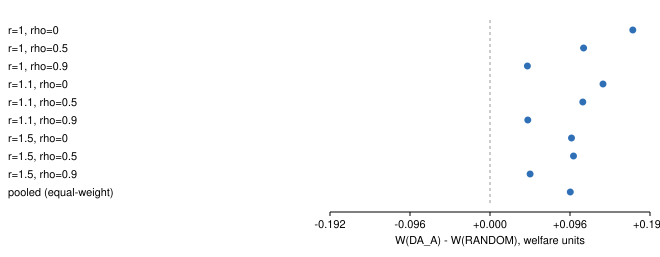
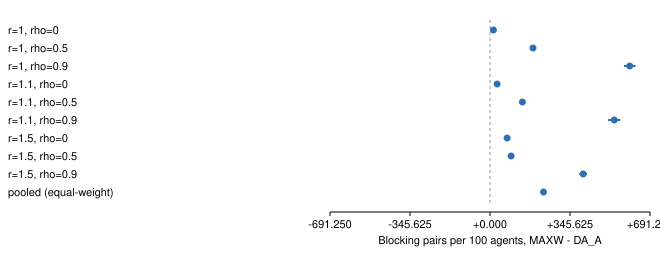
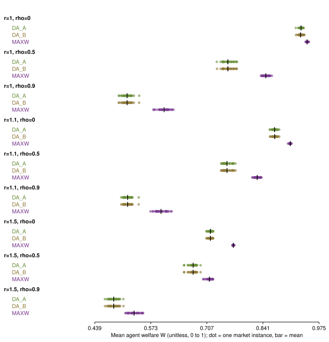

<!-- SPDX-License-Identifier: LicenseRef-MATCH-NC-Research-1.0 -->
# EXP-002 report: centralized two-sided matching versus sequential discovery

## 1. Identification

| Item | Value |
|---|---|
| Experiment | EXP-002, secondary (not in the confirmatory family) |
| Date of run | 2026-11-24 (UTC 23:33:51 to 23:34:06); report written 2026-11-25 |
| Report version | 1.1 (M4: exploratory addendum in section 9; no frozen result changed) |
| Status | Complete: full frozen matrix, 810 of 810 runs, 0 invalid, 0 excluded; the comparator is the EXP-001 RANDOM arm on the same instances (270 runs, 0 invalid) |
| Author | Mohamed Bechir Kefi, independent researcher. AI assistance: Claude (Anthropic) ran the frozen commands and drafted this report as a research and development assistant; it is not an author. |
| Protocol | `research/experiments/EXP-002/protocol.md` v1.0, SHA-256 `30692ad843399f50c1a1141f71b16e6fb704b2669d8ab5dd1e586de67485961c`; main protocol SHA-256 `81f24e9e4bc15434837208705f61619d6415bd1643985142248c926482e160c5` |
| Config | `experiments/configs/EXP-002.json`, file SHA-256 `105c89cc03e8d613cdc593e79775116f0bb38bfa0d55802768c6ac2823c77ac3`, canonical SHA-256 `2bd7ee667eaadef716496cff55bf2a343743f0984e4c1f44552279dea1a540b7` |
| Provenance revision | `cfc90d0dfa9aa9058ee780a8d8fe3abdc77343d3` (clean tree) |

All agents are synthetic. Centralized arms are full-information references, not deployable platform policies. All numbers are copied (rounded) from the committed files named in each section.

## 2. Executive summary

**Question.** On the same synthetic markets as EXP-001, how do centralized matchings differ from sequential random discovery (RANDOM, T = 40) in welfare, unmatched fraction and the gap between sides? The centralized matchings are deferred acceptance with A or B proposing (DA_A, DA_B) and the utilitarian assignment (MAXW). The experiment also asks whether MAXW leaves more blocking pairs than a stable matching.

**Method.** The 270 EXP-001 instances (same root seed 20261124) were each matched by DA_A, DA_B and MAXW and paired with the EXP-001 RANDOM arm. Two secondary contrasts were registered:

- H_a: W(DA_A) - W(RANDOM);
- H_b: blocking pairs per 100 agents, MAXW - DA_A.

Each is the equal-weight mean over 9 cells, with a 95% stratified paired bootstrap CI (10,000 resamples). A CI containing 0 means "not supported". There is no multiplicity protection.

**Outcome.**

- H_a: DA_A gives higher welfare than random sequential discovery, +0.0963 (95% CI +0.0954 to +0.0973); supported.
- H_b: MAXW has more blocking pairs per 100 agents than DA_A, +231.06 (95% CI +226.32 to +235.70); supported.
- The invariant held: 0 instances with a DA blocking pair, for both DA_A and DA_B.

**Principal caveat.** The centralized arms use full preference information that the sequential arms lack, so H_a measures information and mechanism together. These results are secondary.

## 3. Rationale and literature

Deferred acceptance yields a stable matching that is proposer-optimal among stable matchings (Gale and Shapley 1962, DOI 10.1080/00029890.1962.11989827; Roth 1982, DOI 10.1287/moor.7.4.617). Both sources are verified at metadata level only; their full texts were not read, so the facts used here rest on the standard definitions and on this project's tests. Under random preferences, small imbalance strongly favours the short side in stable outcomes (Ashlagi, Kanoria and Leshno 2017, DOI 10.1086/689869, full text opened on 2026-11-25, claim checked against the abstract, p. 69). A utilitarian assignment maximizes total satisfaction but need not be stable. Search frictions are named as a possible reason why stable-matching predictions underpredict some sorting patterns in offline marriages, while predicted and actual online-dating matches were similar (Hitsch, Hortacsu and Ariely 2010, DOI 10.1257/aer.100.1.130, full text opened on 2026-11-25, claim checked against the abstract, p. 130). The working title "Can optimal matching leave more people unhappy?" motivates H_b without presupposing its answer.

## 4. Hypotheses and operational definitions

- H0_a: mean over cells of E[W_DA_A - W_RANDOM] = 0; H1_a: != 0.
- H0_b: mean over cells of E[B_MAXW - B_DA_A] = 0; H1_b: != 0.
  - B is blocking pairs per 100 agents: pairs (i, j) that are mutually acceptable and in which each is unmatched or strictly prefers the other to its partner.
  - B is a pair count, so it is not bounded by 100.
  - B_DA_A = 0 by theorem and is checked as an invariant.
- Descriptive: W by side under DA_A versus DA_B, per cell; unmatched fraction.
- Disconfirmation: a 95% CI containing 0 means the contrast is not supported.
- Model and metrics: `research/protocol.md` sections 2.1, 2.3 and 2.4.
  - DA lists are truncated to acceptable partners.
  - MAXW maximizes the sum of s_ij + s_ji over mutually acceptable pairs (scipy rectangular assignment).

## 5. Methodology

- **Code.** `src/match_lab/matching.py` (DA_A, DA_B, MAXW), `src/match_lab/metrics.py`, `src/match_lab/analysis.py` (`exp002_analysis`, written and committed before any confirmatory output; D-017).
- **Data.** Synthetic, regenerated from the seed. The instances are the EXP-001 ones by construction of the seeds (`data/manifest.json`, SHA-256 `506b2c412984c7a41c436b889c159c5a139744c4a1ccdf7396a7a88427f216cf`).
- **Design.** 9 cells (r in {1.0, 1.1, 1.5}, rho in {0.0, 0.5, 0.9}), 30 instances each, 3 centralized arms, 810 runs; theta = 0.5. The centralized arms are deterministic given the instance, so all uncertainty is between instances.
- **Hardware and software.** Apple M1 Pro, macOS 15.3.1, Python 3.12.1, numpy 2.3.5, scipy 1.16.3; one process under `nice -n 10`, concurrent with EXP-001.
- **Budget.** 30 minutes; used 13.6 s wall clock.

## 6. Implementation verification

- Tests before the run: 103 passed. They cover:
  - hand-computed Gale and Shapley examples;
  - DA zero blocking pairs and proposer optimality, against brute-force enumeration of stable matchings;
  - MAXW against brute force on tiny markets;
  - metric hand values;
  - the EXP-002 analysis on hand-built and end-to-end inputs.
- Smoke (J-0009): an independent naive recomputation of W, U, M and blocking pairs agreed exactly with the stored metrics for DA_A and MAXW on 4 cells.
- In-run: all 810 runs were valid. No DA_A or DA_B run had a blocking pair (`invariant_instances_with_DA_blocking_pairs` = 0 for both in `results/confirmatory/EXP-002/analysis/EXP-002_analysis.json`), so the protocol's stop condition did not trigger.

## 7. Execution record

- Run: `nice -n 10 .venv/bin/python -m match_lab run --config experiments/configs/EXP-002.json`, exit status 0, 2026-11-24T23:33:51Z to 23:34:06Z (manifest wall clock 13.6 s). Log: `results/confirmatory/logs/EXP-002.log`.
- Analysis: `nice -n 10 .venv/bin/python -m match_lab analyze --experiment EXP-002 --exp001 results/confirmatory/EXP-001/results.json --results results/confirmatory/EXP-002/results.json --out results/confirmatory/EXP-002/analysis`.
- Generic tables and figures: `nice -n 10 .venv/bin/python -m match_lab report --results results/confirmatory/EXP-001/results.json results/confirmatory/EXP-002/results.json --out results/confirmatory/EXP-002/report`.
- Runs: 810 planned and executed, 0 invalid, 0 excluded, none dropped, no retry. Run ids `EXP-002/r{r}-rho{rho}-i{000..029}-base/{DA_A,DA_B,MAXW}` are listed in `results/confirmatory/EXP-002/run_manifest.json`.
- **Deviations: none** in design, seeds, config or analysis. The protocol's reproduction command produces only the generic report, which compares arms within one result file. It therefore cannot pair EXP-002 arms with the EXP-001 RANDOM arm. The frozen contrasts are computed instead by the `analyze` command, implemented from protocol sections 4 and 12 before any confirmatory output existed (D-017). The provenance revision `cfc90d0` differs from the frozen-content revision `88f3438` only by records, the analysis module, the CLI and tests. Owner decisions of 2026-11-25 (D-019, D-020) concern EXP-003 S3 and the writing of this report from committed results.

## 8. Results

### 8.1 Registered secondary contrasts

Source: `results/confirmatory/EXP-002/analysis/tables/EXP-002_contrasts.csv` and `EXP-002_analysis.json`.

| Contrast | Estimate (equal-weight, 9 cells) | 95% CI | n instances | Decision |
|---|---|---|---|---|
| H_a: W(DA_A) - W(RANDOM) | +0.0963 | +0.0954 to +0.0973 | 270 | supported |
| H_b: B(MAXW) - B(DA_A), per 100 agents | +231.06 | +226.32 to +235.70 | 270 | supported |

Per cell (same source):

| r, rho | W(DA_A) - W(RND) | 95% CI | B(MAXW) - B(DA_A) | 95% CI |
|---|---|---|---|---|
| 1.0, 0.0 | +0.1714 | +0.1683 to +0.1745 | +14.87 | +14.08 to +15.65 |
| 1.0, 0.5 | +0.1124 | +0.1086 to +0.1163 | +185.69 | +177.08 to +194.05 |
| 1.0, 0.9 | +0.0449 | +0.0421 to +0.0476 | +603.61 | +578.77 to +628.41 |
| 1.1, 0.0 | +0.1355 | +0.1322 to +0.1388 | +30.69 | +29.46 to +31.97 |
| 1.1, 0.5 | +0.1114 | +0.1086 to +0.1141 | +140.05 | +132.66 to +147.41 |
| 1.1, 0.9 | +0.0453 | +0.0429 to +0.0477 | +537.06 | +510.37 to +563.30 |
| 1.5, 0.0 | +0.0978 | +0.0953 to +0.1002 | +73.75 | +71.71 to +75.91 |
| 1.5, 0.5 | +0.1001 | +0.0977 to +0.1025 | +91.28 | +87.51 to +95.57 |
| 1.5, 0.9 | +0.0481 | +0.0456 to +0.0506 | +402.55 | +385.33 to +419.23 |

### 8.2 Descriptive outcomes by arm and cell

Source: `results/confirmatory/EXP-002/analysis/tables/EXP-002_descriptive.csv` (means over 30 instances). "Gap" is W_A - W_B, short side A minus long side B.

| r, rho | W DA_A | W DA_B | W MAXW | W RND | U DA_A | U MAXW | U RND | gap DA_A | gap DA_B | gap MAXW | gap RND |
|---|---|---|---|---|---|---|---|---|---|---|---|
| 1.0, 0.0 | 0.932 | 0.931 | 0.947 | 0.760 | 0.000 | 0.000 | 0.015 | +0.034 | -0.039 | -0.000 | +0.003 |
| 1.0, 0.5 | 0.757 | 0.757 | 0.848 | 0.645 | 0.120 | 0.013 | 0.121 | -0.000 | -0.002 | +0.001 | -0.002 |
| 1.0, 0.9 | 0.516 | 0.516 | 0.605 | 0.471 | 0.350 | 0.217 | 0.344 | +0.002 | +0.001 | +0.002 | -0.000 |
| 1.1, 0.0 | 0.869 | 0.869 | 0.906 | 0.733 | 0.048 | 0.048 | 0.048 | +0.214 | +0.213 | +0.087 | +0.068 |
| 1.1, 0.5 | 0.755 | 0.755 | 0.827 | 0.643 | 0.124 | 0.056 | 0.125 | +0.096 | +0.095 | +0.091 | +0.061 |
| 1.1, 0.9 | 0.517 | 0.517 | 0.597 | 0.472 | 0.351 | 0.239 | 0.342 | +0.068 | +0.067 | +0.072 | +0.055 |
| 1.5, 0.0 | 0.715 | 0.715 | 0.770 | 0.617 | 0.200 | 0.200 | 0.200 | +0.462 | +0.462 | +0.321 | +0.256 |
| 1.5, 0.5 | 0.674 | 0.674 | 0.713 | 0.574 | 0.223 | 0.208 | 0.222 | +0.381 | +0.380 | +0.322 | +0.260 |
| 1.5, 0.9 | 0.484 | 0.484 | 0.533 | 0.436 | 0.398 | 0.348 | 0.393 | +0.257 | +0.256 | +0.266 | +0.210 |

U for DA_B equals U for DA_A in every cell (same CSV). This is what one expects if the set of matched agents is the same in all stable matchings, a standard result that was not verified against a source in this project.

Observations, stated without tests:

1. Proposer advantage appears only in the balanced, idiosyncratic cell (r = 1.0, rho = 0), where DA_A favours A (+0.034) and DA_B favours B (gap -0.039). With any imbalance, DA_A and DA_B are almost identical and favour the short side A strongly (gap up to +0.462). This is consistent with the abstract of Ashlagi et al. (2017).
2. MAXW has the highest W in every cell. It leaves fewer agents unmatched than DA when rho > 0. Its side gap is smaller than DA's at r = 1.1 and r = 1.5 with rho = 0 and 0.5. It is unstable (8.1).
3. RANDOM discovery has the lowest W in every cell and the smallest side gap in every imbalanced cell (r > 1).

### 8.3 Figures

{width=80%}

{width=80%}

{width=80%}

## 9. Interpretation

- **Expected versus observed.** The protocol expected B_DA_A = 0 (it is), and gave no direction for H_a or H_b. The pre-freeze pilot (exploratory, T = 20) did not test these contrasts. Both registered contrasts are clearly non-zero.
- **Measured.** In these synthetic markets, deferred acceptance yields 0.0963 more mean welfare than 40 rounds of random sequential discovery on the same instances. The welfare-maximizing assignment leaves many more blocking pairs than deferred acceptance, which leaves none. The excess grows with preference correlation in each r.
- **Inference.**
  - The DA advantage combines full information and a stable mechanism; this design cannot separate them.
  - MAXW's extra welfare comes with instability that is largest under consensus tastes.
  - In that sense a welfare-optimal matching leaves more pairs who would rather deviate. Whether agents are "unhappier" depends on the measure: MAXW has the higher mean W.
- **M4 addendum (EXPLORATORY, 2026-11-25; J-0014; D-021).** Valuing unmatched agents at any constant v in [0, 1] moves H_a only from +0.0963 to +0.0969 (`results/exploratory/m4_confounders/unmatched_value_sweep.csv`). The mean satisfaction of matched agents is +0.1167 higher under DA_A than under RANDOM (`decomposition.csv`). These diagnostics do not separate information from mechanism and change no verdict.
- **Alternatives.** Truncation of DA lists at the acceptability threshold limits matches. The rank-percentile scale with unmatched = 0 favours arms that match more agents; this check (S3) was not run. Blocking pairs are counted per pair, so denser acceptability among high-correlation pairs can inflate counts.

## 10. Threats to validity

- **Construct.** Blocking pairs per 100 agents is a pair count, not a share of agents; a per-agent instability measure might show different magnitudes. The centralized arms are full-information references.
- **Statistical.** Secondary contrasts without multiplicity protection; an equal-weight average over 9 chosen cells.
- **External.** As EXP-001: synthetic Gaussian utilities, one market size, capacity one. No claim about real markets.
- **Internal.** The centralized arms are deterministic. The RANDOM comparator is the EXP-001 arm on the same instance keys; the analysis paired 270 instances per contrast.

## 11. Conclusion and next experiment

These results are secondary, at the frozen level of evidence:

- Deferred acceptance gives higher mean welfare than random sequential discovery: +0.0963, 95% CI +0.0954 to +0.0973.
- The utilitarian assignment leaves more blocking pairs than deferred acceptance: +231.06 per 100 agents, 95% CI +226.32 to +235.70.

Possible follow-ups: a per-agent instability measure, and a sequential arm with full information to separate information from mechanism.

## 12. Reproduction appendix

- Environment and tolerance as EXP-001 (`uv.lock`; metrics deterministic; fixed analysis seeds).
- Commands and provenance: `research/experiments/EXP-002/reproduction.md`.
- Raw outputs:
  - run: `results/confirmatory/EXP-002/results.json`, `run_manifest.json`, `metrics.csv`;
  - analysis: `results/confirmatory/EXP-002/analysis/`;
  - checksums: SHA-256 in `results/confirmatory/EXP-002/SHA256SUMS`.
- The RANDOM comparator requires `results/confirmatory/EXP-001/results.json`.
- References: `research/paper/references.bib`; verification levels in `research/literature_review.md`.
