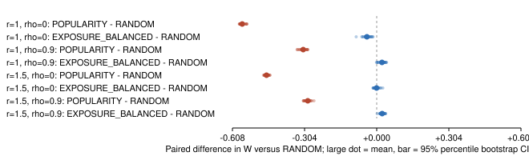
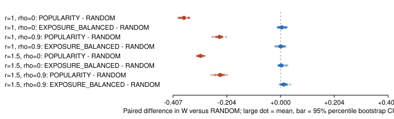
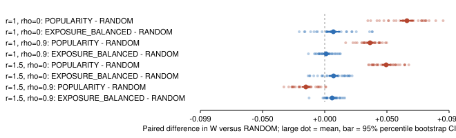
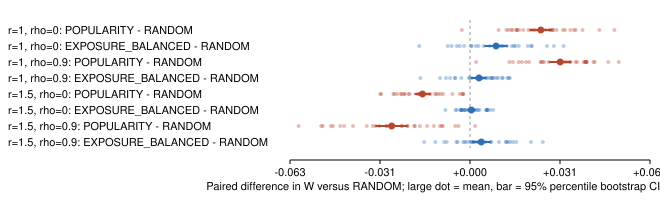

<!-- SPDX-License-Identifier: LicenseRef-MATCH-NC-Research-1.0 -->
# EXP-003 report: sensitivity of the exposure-policy effect

## 1. Identification

| Item | Value |
|---|---|
| Experiment | EXP-003, sensitivity (can invalidate the EXP-001 interpretation; no confirmatory hypothesis) |
| Date of run | 2026-11-24 (UTC 23:38:15 to 23:44:49); report written 2026-11-25 |
| Report version | 1.1 (M4: exploratory addendum in section 9; no frozen result changed) |
| Status | Partial. S1 and S2 complete: 1,440 of 1,440 runs, 0 invalid, 0 excluded. S3 not run: a documented failure under the M3 gate (owner decision D-019) |
| Author | Mohamed Bechir Kefi (no affiliation). AI assistance: Claude (Anthropic) ran the frozen commands and drafted this report as a research and development assistant; it is not an author. |
| Protocol | `research/experiments/EXP-003/protocol.md` v1.0, SHA-256 `7e37ac6ad46f9da93bd66763a7caf3f53e97a367b83d31e727e14f35ded628f6`; main protocol SHA-256 `81f24e9e4bc15434837208705f61619d6415bd1643985142248c926482e160c5` |
| Config | `experiments/configs/EXP-003.json`, file SHA-256 `c22013c6a6799ef317890eab5784cdc4f2a5acad2cc8eafd35d5038a0ead9a1b`, canonical SHA-256 `91669781cf730391a79dcc6a36e3317a5c7f83202c2a603c3e393d563bc37489` |
| Provenance revision | `cfc90d0dfa9aa9058ee780a8d8fe3abdc77343d3` (clean tree) |

All agents are synthetic. All numbers are copied (rounded) from the committed files named in each section.

## 2. Executive summary

**Question.** Does the sign of theta_P from EXP-001 survive changes in pickiness (theta), horizon (T) and the welfare definition?

**Method.** The EXP-001 instances of the 4 corner cells were used (r in {1.0, 1.5}, rho in {0.0, 0.9}; 30 each; same seeds). The three sequential arms were re-run under four settings:
- S1: theta = 0.3 and 0.7 at T = 40;
- S2: T = 10 and T = 20 at theta = 0.5.

For each setting, theta_P(s) is the equal-weight mean over the 4 cells, with a 95% stratified bootstrap CI. The frozen invalidation criterion is: the opposite sign to the EXP-001 estimate, with a 95% CI excluding 0, for any setting in S2 or S3.

**Outcome.**
- POPULARITY meets the criterion at both S2 horizons: -0.4081 at T = 10 and -0.2824 at T = 20, both CIs far from 0, against +0.0219 in EXP-001. The EXP-001 POPULARITY result is therefore reported as **not robust**.
- EXPOSURE_BALANCED does not meet the criterion.
- Under S1, both policies keep the EXP-001 sign.
- S3 was not run.

**Principal caveat.** Without S3, the dependence of both verdicts on the welfare definition is unknown.

## 3. Rationale and literature

A policy can look better within a fixed horizon only because it produces matches faster; truncation is not a final outcome. A rank-percentile welfare with unmatched scored 0 rewards matching anyone acceptable. Pickiness changes how many likes become mutual. These are the competing explanations listed in the EXP-001 protocol. Background sources: `research/literature_review.md`. No source fixes the expected direction of these sensitivities.

## 4. Hypotheses and operational definitions

- For each setting s and policy P: theta_P(s) = (1/4) sum over corner cells of E[W_P - W_RANDOM | cell, s], paired by instance.
- Invalidation (fixed in advance): if theta_P(s) has the opposite sign of the EXP-001 estimate, with a 95% CI excluding 0, for any s in S2 or S3, the EXP-001 result for P is reported as not robust.
  - The EXP-001 signs are POPULARITY +, from +0.0219, and EXPOSURE_BALANCED +, from +0.0004 (`results/confirmatory/EXP-003/analysis/tables/EXP-003_exp001_reference.csv`).
- S1 is reported as sensitivity evidence; it is not part of the criterion. There is no multiplicity correction and no p-value (protocol section 8).
- S3 as frozen: reanalysis of EXP-001 raw outputs with (a) welfare from standardized raw utility and (b) unmatched value equal to the acceptability threshold's satisfaction.

## 5. Methodology

- **Code.** `src/match_lab/sequential.py` and `metrics.py` (unchanged from EXP-001); `src/match_lab/analysis.py` (`exp003_analysis`, written and committed before any confirmatory output; D-017).
- **Data.** Synthetic. The same instance seeds as EXP-001 (root 20261124); theta consumes no randomness and T only truncates the same streams (`data/manifest.json`, SHA-256 `506b2c412984c7a41c436b889c159c5a139744c4a1ccdf7396a7a88427f216cf`).
- **Design.** 4 cells x 30 instances x 3 arms x 4 settings = 1,440 runs.
- **Hardware and software.** Apple M1 Pro, macOS 15.3.1, Python 3.12.1, numpy 2.3.5, scipy 1.16.3. One process under `nice -n 10`.
- **Budget.** 30 minutes; used 392.3 s wall clock.
- **Statistical plan (as frozen).** Stratified bootstrap over instances (10,000 resamples), 95% CI per setting and policy.

## 6. Implementation verification

- Tests before the run: 103 passed. They include the EXP-003 analysis on a hand-built case, which checks that S2 can invalidate, S1 does not enter the criterion, and a same-sign result does not invalidate.
- Smoke (J-0009) as for EXP-001.
- In-run: all 1,440 runs were valid. No instance had zero matches. Exposure-cap shortening of EXPOSURE_BALANCED slates was at most 1.62% of slates in any cell and setting (`results/confirmatory/EXP-003/report/tables/EXP-003_arm_summary.csv`).
- Consistency check: at T = 20 the RANDOM welfare of three corner cells (r = 1.0, rho = 0: 0.7605; r = 1.5, rho = 0: 0.6173; r = 1.0, rho = 0.9: 0.4709) is equal or nearly equal to its T = 40 value in EXP-001 (0.7605, 0.6173, 0.4710). This is consistent with RANDOM ceasing to form matches early in those cells, as seen in the M2 pilot.

## 7. Execution record

- Run: `nice -n 10 .venv/bin/python -m match_lab run --config experiments/configs/EXP-003.json`, exit status 0, 2026-11-24T23:38:15Z to 23:44:49Z (manifest wall clock 392.3 s). Log: `results/confirmatory/logs/EXP-003.log`.
- Analysis: `nice -n 10 .venv/bin/python -m match_lab analyze --experiment EXP-003 --exp001 results/confirmatory/EXP-001/results.json --results results/confirmatory/EXP-003/results.json --out results/confirmatory/EXP-003/analysis`.
- Generic tables and figures: `nice -n 10 .venv/bin/python -m match_lab report --results results/confirmatory/EXP-003/results.json --out results/confirmatory/EXP-003/report`. Its pooled table uses a different fixed bootstrap stream from the `analyze` command, so its CIs can differ in the last digits. The frozen-rule figures in this report come from the analysis tables.
- Runs: 1,440 planned and executed for S1 and S2, 0 invalid, 0 excluded, none dropped, no retry. Run ids `EXP-003/r{r}-rho{rho}-i{000..029}-{setting}/{arm}` are listed in `results/confirmatory/EXP-003/run_manifest.json`.
- **Deviation: S3 not run** (journal J-0013; decisions D-018, D-019; `research/freeze.json`, `post_freeze_deviations`). There were two reasons:
  1. The EXP-001 raw outputs store per-run metrics only, not matchings or utilities, so S3 cannot be computed by reanalysis.
  2. The frozen text does not fix how utility is standardized, the unmatched value under (a), or how the threshold's satisfaction is computed under (b).

  The owner decided on 2026-11-25 ("approve all recommendations, RIGGED A") that S3 is recorded as not run, a documented failure under the M3 gate, and that its parameters are not chosen after the data. No S3 code exists.
- The provenance revision `cfc90d0` differs from the frozen-content revision `88f3438` only by records, the analysis module, the CLI and tests (D-017).

## 8. Results

### 8.1 theta_P by setting (corner cells)

Source: `results/confirmatory/EXP-003/analysis/tables/EXP-003_sensitivity.csv` (120 paired instances per row).

| Setting | Policy | theta_P | 95% CI | Opposite sign, CI excl. 0 | Invalidates (S2 only) |
|---|---|---|---|---|---|
| EXP-001 base (T 40, theta 0.5), reference | POPULARITY | +0.0169 | +0.0150 to +0.0188 | n/a | n/a |
| EXP-001 base (T 40, theta 0.5), reference | EXPOSURE_BALANCED | +0.0027 | +0.0011 to +0.0043 | n/a | n/a |
| S1 theta 0.3 (T 40) | POPULARITY | +0.0340 | +0.0321 to +0.0359 | no | not a criterion |
| S1 theta 0.3 (T 40) | EXPOSURE_BALANCED | +0.0052 | +0.0034 to +0.0070 | no | not a criterion |
| S1 theta 0.7 (T 40) | POPULARITY | +0.0030 | +0.0009 to +0.0052 | no | not a criterion |
| S1 theta 0.7 (T 40) | EXPOSURE_BALANCED | +0.0041 | +0.0026 to +0.0057 | no | not a criterion |
| S2 T 10 | POPULARITY | -0.4081 | -0.4098 to -0.4064 | yes | **yes** |
| S2 T 10 | EXPOSURE_BALANCED | +0.0008 | -0.0012 to +0.0028 | no | no |
| S2 T 20 | POPULARITY | -0.2824 | -0.2843 to -0.2805 | yes | **yes** |
| S2 T 20 | EXPOSURE_BALANCED | +0.0049 | +0.0033 to +0.0066 | no | no |

The analysis output (`EXP-003_analysis.json`, `verdict_by_arm`) gives these verdicts:
- POPULARITY: "not robust (S2 invalidation criterion met)";
- EXPOSURE_BALANCED: "S2 criterion not met; S3 not executed".

### 8.2 Welfare and unmatched fraction under S2 (descriptive)

Source: `results/confirmatory/EXP-003/report/tables/EXP-003_arm_summary.csv` (means over 30 instances).

| Setting | r, rho | W RND | W POP | W EXB | U RND | U POP | U EXB |
|---|---|---|---|---|---|---|---|
| S2 T 10 | 1.0, 0.0 | 0.7601 | 0.1930 | 0.7189 | 0.0152 | 0.7615 | 0.0715 |
| S2 T 10 | 1.0, 0.9 | 0.4263 | 0.1163 | 0.4484 | 0.4177 | 0.8452 | 0.3847 |
| S2 T 10 | 1.5, 0.0 | 0.6173 | 0.1528 | 0.6168 | 0.2000 | 0.8107 | 0.2037 |
| S2 T 10 | 1.5, 0.9 | 0.3826 | 0.0919 | 0.4054 | 0.4773 | 0.8779 | 0.4463 |
| S2 T 20 | 1.0, 0.0 | 0.7605 | 0.3946 | 0.7649 | 0.0147 | 0.5113 | 0.0133 |
| S2 T 20 | 1.0, 0.9 | 0.4709 | 0.2397 | 0.4716 | 0.3442 | 0.6765 | 0.3462 |
| S2 T 20 | 1.5, 0.0 | 0.6173 | 0.3141 | 0.6199 | 0.2000 | 0.6103 | 0.2000 |
| S2 T 20 | 1.5, 0.9 | 0.4247 | 0.1955 | 0.4366 | 0.4105 | 0.7361 | 0.3959 |

Under the shared per-round tie key, POPULARITY leaves most agents unmatched at short horizons: U is 0.7615 to 0.8779 at T = 10, against 0.0152 to 0.4773 for RANDOM. Its welfare deficit at T = 10 and 20 is a matching-throughput effect.

### 8.3 Welfare under S1 (descriptive)

Same source.

| Setting | r, rho | W RND | W POP | W EXB |
|---|---|---|---|---|
| S1 theta 0.3 | 1.0, 0.0 | 0.6833 | 0.7490 | 0.6902 |
| S1 theta 0.3 | 1.0, 0.9 | 0.5107 | 0.5470 | 0.5118 |
| S1 theta 0.3 | 1.5, 0.0 | 0.5483 | 0.5975 | 0.5554 |
| S1 theta 0.3 | 1.5, 0.9 | 0.4534 | 0.4383 | 0.4593 |
| S1 theta 0.7 | 1.0, 0.0 | 0.8166 | 0.8412 | 0.8257 |
| S1 theta 0.7 | 1.0, 0.9 | 0.3667 | 0.3981 | 0.3699 |
| S1 theta 0.7 | 1.5, 0.0 | 0.6878 | 0.6713 | 0.6883 |
| S1 theta 0.7 | 1.5, 0.9 | 0.3492 | 0.3219 | 0.3531 |

In the r = 1.5, rho = 0.9 cell, POPULARITY's welfare is below RANDOM's under both S1 settings, as in EXP-001.

### 8.4 Figures

{width=80%}

{width=80%}

{width=80%}

{width=80%}

{width=80%}

Welfare strip plots per setting are in `figures/FIG-EXP-003-*-welfare.svg`.

## 9. Interpretation

- **Expected versus observed.** The protocol anticipated that the policy effect might be "about the speed of matching within a fixed horizon, not about final outcomes" (protocol section 7). The pre-freeze pilot had shown POPULARITY negative at T = 10 and T = 20 on corner cells (C4 disclosure: -0.4068 at T = 10; -0.2917 at T = 20 over 9 cells). The confirmatory S2 values agree in sign and size. The anticipated speed effect is confirmed.
- **POPULARITY.** The welfare gain at T = 40 coexists with a large welfare loss at T = 10 and 20. That loss comes with most agents left unmatched (8.2). The T = 40 result therefore answers "which policy has more welfare after 40 rounds", not "which policy produces better final allocations". Under the frozen rule, the EXP-001 POPULARITY claim is restated as not robust to the horizon. The S1 results show that, at T = 40, the sign does not depend on pickiness within theta 0.3 to 0.7, although the effect at theta = 0.7 is small (+0.0030).
- **EXPOSURE_BALANCED.** Its EXP-001 estimate is near zero (+0.0004), so a sign-based criterion is weak for it. It stays non-negative in every setting; its CI excludes 0 in some settings (for example +0.0049 at T = 20) but not at T = 10. Its EXP-001 equivalence statement (margin 0.01) is not contradicted by any S1 or S2 estimate, all of which lie below +0.0060.
- **M4 addendum (EXPLORATORY, 2026-11-25; J-0014, J-0015; D-021).** These diagnostics were computed after the results were known and change no verdict.
  - The S2 POPULARITY reversals would change sign only if an unmatched agent were valued at a constant of at least 0.75 (T = 10) or 0.72 (T = 20) on the satisfaction scale; at 0.5 they stay negative (-0.1349 and -0.0868) (`results/exploratory/m4_confounders/unmatched_value_sweep.csv`). This covers only a constant unmatched value, not S3.
  - The mean satisfaction of matched agents under POPULARITY is higher than under RANDOM at T = 10 (+0.0282), as at T = 40, so the reversal comes from the matched share (-0.5463 at T = 10) (`decomposition.csv`).
  - At the primary T = 40 itself, POPULARITY was still forming matches in every instance (J-0014), and in an exploratory probe its contrast was larger at T = 80 (+0.0375) than at T = 40 (J-0015). The horizon dependence therefore runs in both directions around T = 40.
- **Not resolved.** Whether either conclusion depends on the welfare definition (S3) cannot be answered from this experiment.

## 10. Threats to validity

- **Construct.** S3 was not run, so the rank-percentile scale and the treatment of unmatched agents remain untested alternatives.
- **Statistical.** Corner cells only (4 of 9). No multiplicity correction. The criterion uses the EXP-001 sign even when the EXP-001 estimate is near zero.
- **Internal.** The instances are the same as EXP-001 and paired; the settings share the market draws.
- **External.** As EXP-001: synthetic model, one market size, a stylized popularity score with a shared per-round tie key. A different tie rule changes POPULARITY's throughput, as the pre-freeze probe J-0005 showed.

## 11. Conclusion and next experiment

At the frozen level of evidence:
- The EXP-001 POPULARITY effect is not robust to the horizon. It reverses at T = 10 (-0.4081, 95% CI -0.4098 to -0.4064) and T = 20 (-0.2824, 95% CI -0.2843 to -0.2805).
- The EXPOSURE_BALANCED result is not invalidated by S1 or S2.
- S3 was not run (documented failure, owner decision D-019).

Possible follow-ups: a pre-registered horizon-free outcome; a fully specified metric-definition sensitivity, with matchings retained in the raw outputs so that a reanalysis is possible.

## 12. Reproduction appendix

- Environment and tolerance as EXP-001.
- Commands and provenance: `research/experiments/EXP-003/reproduction.md`.
- Raw outputs:
  - run: `results/confirmatory/EXP-003/results.json`, `run_manifest.json`, `metrics.csv`;
  - analysis: `results/confirmatory/EXP-003/analysis/`;
  - generic tables: `results/confirmatory/EXP-003/report/tables/`;
  - checksums: SHA-256 in `results/confirmatory/EXP-003/SHA256SUMS`.
- The EXP-001 reference requires `results/confirmatory/EXP-001/results.json`.
- References: `research/paper/references.bib`; verification levels in `research/literature_review.md`.
