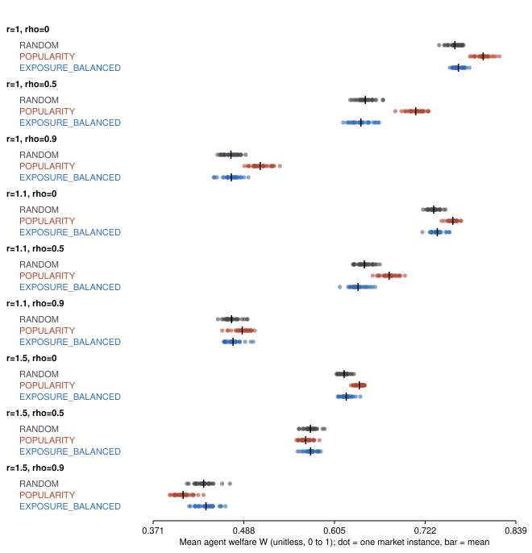
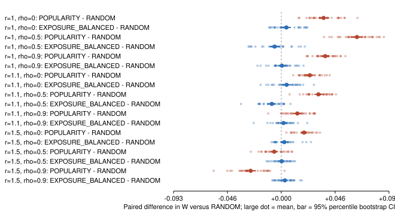
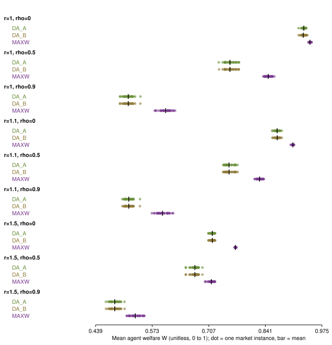

<!-- SPDX-License-Identifier: LicenseRef-MATCH-NC-Research-1.0 -->
# MATCH run report

Generated by `python -m match_lab report` from validated result files. All participants are synthetic.

Arm abbreviations in tables: RND = RANDOM, POP = POPULARITY, EXB = EXPOSURE_BALANCED; DA_A, DA_B and MAXW as in the protocol.

## EXP-001 (confirmatory): EXP-001 exposure policies in sequential discovery (FROZEN v1.0, owner-approved 2026-11-24; T = 40, shared per-round tie key)

- Result file: `results/confirmatory/EXP-001/results.json`
- Config SHA-256: `5e747575d51c0b0253ffcc20ca22fdb1e0f3770c7421f1546f7ff8ebc93df422`
- Code revision: `cfc90d0dfa9aa9058ee780a8d8fe3abdc77343d3`; generator: GEN-match-market v1
- Root seed: 20261124; n_A = 200; r in [1.0, 1.1, 1.5]; rho in [0.0, 0.5, 0.9]; 30 instances per cell; settings: base (theta 0.5, T 40)
- Runs: 810; total runtime of runs 200.94 s

### Arm summary (mean and SD over instances)

| setting | r, rho | arm | n | W | SD(W) | U | M | Gini exp. B | block/100 | runtime s |
|---|---|---|---|---|---|---|---|---|---|---|
| base | 1, 0 | RND | 30 | 0.7605 | 0.0079 | 0.0147 | 0.6901 | 0.2420 | 531.4333 | 0.0707 |
| base | 1, 0 | POP | 30 | 0.7970 | 0.0089 | 0.0115 | 0.7277 | 0.3167 | 380.7917 | 0.1337 |
| base | 1, 0 | EXB | 30 | 0.7649 | 0.0063 | 0.0133 | 0.6932 | 0.2869 | 516.7750 | 0.0751 |
| base | 1, 0.5 | RND | 30 | 0.6446 | 0.0104 | 0.1210 | 0.6547 | 0.3127 | 668.3750 | 0.0842 |
| base | 1, 0.5 | POP | 30 | 0.7099 | 0.0105 | 0.0778 | 0.6927 | 0.2759 | 441.6167 | 0.1476 |
| base | 1, 0.5 | EXB | 30 | 0.6389 | 0.0123 | 0.1370 | 0.6631 | 0.2823 | 598.8500 | 0.0902 |
| base | 1, 0.9 | RND | 30 | 0.4710 | 0.0096 | 0.3440 | 0.6413 | 0.3777 | 699.7250 | 0.1166 |
| base | 1, 0.9 | POP | 30 | 0.5089 | 0.0113 | 0.3068 | 0.6663 | 0.1728 | 488.6083 | 0.2003 |
| base | 1, 0.9 | EXB | 30 | 0.4716 | 0.0104 | 0.3462 | 0.6427 | 0.3371 | 690.2917 | 0.1271 |
| base | 1.1, 0 | RND | 30 | 0.7330 | 0.0068 | 0.0479 | 0.6872 | 0.2226 | 605.7778 | 0.0989 |
| base | 1.1, 0 | POP | 30 | 0.7577 | 0.0057 | 0.0595 | 0.7282 | 0.3788 | 458.5635 | 0.1927 |
| base | 1.1, 0 | EXB | 30 | 0.7376 | 0.0075 | 0.0478 | 0.6936 | 0.2986 | 581.3651 | 0.1010 |
| base | 1.1, 0.5 | RND | 30 | 0.6434 | 0.0095 | 0.1254 | 0.6551 | 0.2954 | 716.1349 | 0.1887 |
| base | 1.1, 0.5 | POP | 30 | 0.6755 | 0.0097 | 0.1194 | 0.6919 | 0.3427 | 533.8095 | 0.3439 |
| base | 1.1, 0.5 | EXB | 30 | 0.6353 | 0.0101 | 0.1386 | 0.6582 | 0.2708 | 654.9286 | 0.2118 |
| base | 1.1, 0.9 | RND | 30 | 0.4718 | 0.0091 | 0.3421 | 0.6387 | 0.3705 | 756.6746 | 0.2829 |
| base | 1.1, 0.9 | POP | 30 | 0.4857 | 0.0101 | 0.3384 | 0.6649 | 0.2493 | 600.6825 | 0.4672 |
| base | 1.1, 0.9 | EXB | 30 | 0.4737 | 0.0096 | 0.3432 | 0.6432 | 0.3328 | 727.1190 | 0.3021 |
| base | 1.5, 0 | RND | 30 | 0.6173 | 0.0060 | 0.2000 | 0.6889 | 0.1900 | 870.3533 | 0.2848 |
| base | 1.5, 0 | POP | 30 | 0.6369 | 0.0051 | 0.2101 | 0.7280 | 0.5442 | 701.4600 | 0.5996 |
| base | 1.5, 0 | EXB | 30 | 0.6199 | 0.0066 | 0.2000 | 0.6928 | 0.3217 | 844.5000 | 0.3435 |
| base | 1.5, 0.5 | RND | 30 | 0.5738 | 0.0077 | 0.2219 | 0.6557 | 0.2405 | 889.6533 | 0.2737 |
| base | 1.5, 0.5 | POP | 30 | 0.5677 | 0.0074 | 0.2613 | 0.6929 | 0.5168 | 803.9333 | 0.4944 |
| base | 1.5, 0.5 | EXB | 30 | 0.5740 | 0.0070 | 0.2263 | 0.6599 | 0.2788 | 825.8667 | 0.2815 |
| base | 1.5, 0.9 | RND | 30 | 0.4358 | 0.0117 | 0.3925 | 0.6346 | 0.3370 | 954.2667 | 0.3519 |
| base | 1.5, 0.9 | POP | 30 | 0.4093 | 0.0106 | 0.4427 | 0.6660 | 0.4494 | 895.8200 | 0.4967 |
| base | 1.5, 0.9 | EXB | 30 | 0.4388 | 0.0119 | 0.3921 | 0.6394 | 0.3133 | 913.3667 | 0.3370 |

### Paired differences in W versus RANDOM, per cell

Mean, SD and dz of per-instance paired differences; 95% percentile bootstrap CI over instances (10,000 resamples). `N(SESOI)` is the normal-approximation number of instances per cell for 80% power to detect a difference of 0.01 in that cell, using this run's SD (planning only).

| setting | r, rho | contrast | n | mean D | SD(D) | dz | CI lo | CI hi | N(SESOI) |
|---|---|---|---|---|---|---|---|---|---|
| base | 1, 0 | POP - RND | 30 | 0.0365 | 0.0123 | 2.9778 | 0.0323 | 0.0410 | 12 |
| base | 1, 0 | EXB - RND | 30 | 0.0045 | 0.0107 | 0.4186 | 0.0007 | 0.0083 | 9 |
| base | 1, 0.5 | POP - RND | 30 | 0.0652 | 0.0137 | 4.7659 | 0.0603 | 0.0699 | 15 |
| base | 1, 0.5 | EXB - RND | 30 | -0.0057 | 0.0126 | -0.4536 | -0.0101 | -0.0013 | 13 |
| base | 1, 0.9 | POP - RND | 30 | 0.0379 | 0.0086 | 4.3885 | 0.0348 | 0.0410 | 6 |
| base | 1, 0.9 | EXB - RND | 30 | 0.0006 | 0.0094 | 0.0623 | -0.0027 | 0.0038 | 7 |
| base | 1.1, 0 | POP - RND | 30 | 0.0246 | 0.0078 | 3.1684 | 0.0219 | 0.0274 | 5 |
| base | 1.1, 0 | EXB - RND | 30 | 0.0046 | 0.0104 | 0.4421 | 0.0008 | 0.0082 | 9 |
| base | 1.1, 0.5 | POP - RND | 30 | 0.0320 | 0.0097 | 3.3127 | 0.0285 | 0.0353 | 8 |
| base | 1.1, 0.5 | EXB - RND | 30 | -0.0082 | 0.0091 | -0.8979 | -0.0115 | -0.0051 | 7 |
| base | 1.1, 0.9 | POP - RND | 30 | 0.0138 | 0.0103 | 1.3446 | 0.0102 | 0.0174 | 9 |
| base | 1.1, 0.9 | EXB - RND | 30 | 0.0019 | 0.0086 | 0.2213 | -0.0012 | 0.0048 | 6 |
| base | 1.5, 0 | POP - RND | 30 | 0.0196 | 0.0070 | 2.8087 | 0.0171 | 0.0221 | 4 |
| base | 1.5, 0 | EXB - RND | 30 | 0.0026 | 0.0084 | 0.3127 | -0.0002 | 0.0057 | 6 |
| base | 1.5, 0.5 | POP - RND | 30 | -0.0061 | 0.0087 | -0.6968 | -0.0091 | -0.0030 | 6 |
| base | 1.5, 0.5 | EXB - RND | 30 | 0.0003 | 0.0067 | 0.0437 | -0.0020 | 0.0026 | 4 |
| base | 1.5, 0.9 | POP - RND | 30 | -0.0264 | 0.0131 | -2.0229 | -0.0309 | -0.0219 | 14 |
| base | 1.5, 0.9 | EXB - RND | 30 | 0.0031 | 0.0070 | 0.4430 | 0.0006 | 0.0056 | 4 |

### Equal-weight mean over cells (theta) of W differences versus RANDOM

Stratified bootstrap CIs. `N/cell pooled` is the instances per cell needed for 80% power on the pooled contrast at effect 0.01, from this run's per-cell SDs (planning only).

| setting | arm | cells | theta | 95% lo | 95% hi | 90% lo | 90% hi | N/cell pooled | p | p Holm |
|---|---|---|---|---|---|---|---|---|---|---|
| base | EXB | 9 | 0.0004 | -0.0007 | 0.0015 | -0.0005 | 0.0013 | 1 | 0.5137 | 0.5137 |
| base | POP | 9 | 0.0219 | 0.0207 | 0.0231 | 0.0209 | 0.0229 | 1 | 0.0001 | 0.0002 |

### Degenerate-case checks

- Invalid runs: 0 of 810; excluded instances: 0.
- base r=1, rho=0 EXPOSURE_BALANCED: 0.0% of slates shortened by the exposure cap.
- base r=1, rho=0.5 EXPOSURE_BALANCED: 0.7% of slates shortened by the exposure cap.
- base r=1, rho=0.9 EXPOSURE_BALANCED: 1.0% of slates shortened by the exposure cap.
- base r=1.1, rho=0 EXPOSURE_BALANCED: 0.0% of slates shortened by the exposure cap.
- base r=1.1, rho=0.5 EXPOSURE_BALANCED: 0.7% of slates shortened by the exposure cap.
- base r=1.1, rho=0.9 EXPOSURE_BALANCED: 1.0% of slates shortened by the exposure cap.
- base r=1.5, rho=0 EXPOSURE_BALANCED: 0.0% of slates shortened by the exposure cap.
- base r=1.5, rho=0.5 EXPOSURE_BALANCED: 0.4% of slates shortened by the exposure cap.
- base r=1.5, rho=0.9 EXPOSURE_BALANCED: 1.0% of slates shortened by the exposure cap.

{width=80%}

{width=80%}

## EXP-002 (confirmatory): EXP-002 centralized matching (FROZEN v1.0, owner-approved 2026-11-24; same root seed and instances as EXP-001)

- Result file: `results/confirmatory/EXP-002/results.json`
- Config SHA-256: `2bd7ee667eaadef716496cff55bf2a343743f0984e4c1f44552279dea1a540b7`
- Code revision: `cfc90d0dfa9aa9058ee780a8d8fe3abdc77343d3`; generator: GEN-match-market v1
- Root seed: 20261124; n_A = 200; r in [1.0, 1.1, 1.5]; rho in [0.0, 0.5, 0.9]; 30 instances per cell; settings: base (theta 0.5, T 40)
- Runs: 810; total runtime of runs 10.92 s

### Arm summary (mean and SD over instances)

| setting | r, rho | arm | n | W | SD(W) | U | M | Gini exp. B | block/100 | runtime s |
|---|---|---|---|---|---|---|---|---|---|---|
| base | 1, 0 | DA_A | 30 | 0.9319 | 0.0039 | 0.0002 | 0.8944 | n/a | 0.0000 | 0.0140 |
| base | 1, 0 | DA_B | 30 | 0.9308 | 0.0048 | 0.0002 | 0.8918 | n/a | 0.0000 | 0.0135 |
| base | 1, 0 | MAXW | 30 | 0.9466 | 0.0017 | 0.0000 | 0.9182 | n/a | 14.8667 | 0.0014 |
| base | 1, 0.5 | DA_A | 30 | 0.7570 | 0.0122 | 0.1200 | 0.8165 | n/a | 0.0000 | 0.0140 |
| base | 1, 0.5 | DA_B | 30 | 0.7571 | 0.0122 | 0.1200 | 0.8166 | n/a | 0.0000 | 0.0138 |
| base | 1, 0.5 | MAXW | 30 | 0.8478 | 0.0070 | 0.0130 | 0.7981 | n/a | 185.6917 | 0.0024 |
| base | 1, 0.9 | DA_A | 30 | 0.5159 | 0.0107 | 0.3498 | 0.7654 | n/a | 0.0000 | 0.0149 |
| base | 1, 0.9 | DA_B | 30 | 0.5158 | 0.0107 | 0.3498 | 0.7653 | n/a | 0.0000 | 0.0140 |
| base | 1, 0.9 | MAXW | 30 | 0.6046 | 0.0128 | 0.2168 | 0.6881 | n/a | 603.6083 | 0.0027 |
| base | 1.1, 0 | DA_A | 30 | 0.8686 | 0.0051 | 0.0476 | 0.8410 | n/a | 0.0000 | 0.0158 |
| base | 1.1, 0 | DA_B | 30 | 0.8690 | 0.0051 | 0.0476 | 0.8419 | n/a | 0.0000 | 0.0174 |
| base | 1.1, 0 | MAXW | 30 | 0.9062 | 0.0016 | 0.0476 | 0.9260 | n/a | 30.6905 | 0.0011 |
| base | 1.1, 0.5 | DA_A | 30 | 0.7548 | 0.0098 | 0.1243 | 0.8174 | n/a | 0.0000 | 0.0176 |
| base | 1.1, 0.5 | DA_B | 30 | 0.7550 | 0.0098 | 0.1243 | 0.8179 | n/a | 0.0000 | 0.0171 |
| base | 1.1, 0.5 | MAXW | 30 | 0.8270 | 0.0058 | 0.0559 | 0.8208 | n/a | 140.0476 | 0.0039 |
| base | 1.1, 0.9 | DA_A | 30 | 0.5172 | 0.0092 | 0.3514 | 0.7670 | n/a | 0.0000 | 0.0217 |
| base | 1.1, 0.9 | DA_B | 30 | 0.5172 | 0.0092 | 0.3514 | 0.7672 | n/a | 0.0000 | 0.0217 |
| base | 1.1, 0.9 | MAXW | 30 | 0.5971 | 0.0133 | 0.2392 | 0.7052 | n/a | 537.0556 | 0.0037 |
| base | 1.5, 0 | DA_A | 30 | 0.7152 | 0.0042 | 0.2000 | 0.7953 | n/a | 0.0000 | 0.0218 |
| base | 1.5, 0 | DA_B | 30 | 0.7152 | 0.0042 | 0.2000 | 0.7955 | n/a | 0.0000 | 0.0254 |
| base | 1.5, 0 | MAXW | 30 | 0.7700 | 0.0011 | 0.2000 | 0.9425 | n/a | 73.7467 | 0.0012 |
| base | 1.5, 0.5 | DA_A | 30 | 0.6739 | 0.0087 | 0.2232 | 0.8005 | n/a | 0.0000 | 0.0206 |
| base | 1.5, 0.5 | DA_B | 30 | 0.6739 | 0.0087 | 0.2232 | 0.8006 | n/a | 0.0000 | 0.0225 |
| base | 1.5, 0.5 | MAXW | 30 | 0.7130 | 0.0062 | 0.2080 | 0.8559 | n/a | 91.2800 | 0.0019 |
| base | 1.5, 0.9 | DA_A | 30 | 0.4839 | 0.0103 | 0.3977 | 0.7554 | n/a | 0.0000 | 0.0266 |
| base | 1.5, 0.9 | DA_B | 30 | 0.4839 | 0.0104 | 0.3977 | 0.7558 | n/a | 0.0000 | 0.0303 |
| base | 1.5, 0.9 | MAXW | 30 | 0.5327 | 0.0124 | 0.3476 | 0.7456 | n/a | 402.5533 | 0.0033 |

### Paired differences in W versus RANDOM, per cell

Mean, SD and dz of per-instance paired differences; 95% percentile bootstrap CI over instances (10,000 resamples). `N(SESOI)` is the normal-approximation number of instances per cell for 80% power to detect a difference of 0.01 in that cell, using this run's SD (planning only).

| setting | r, rho | contrast | n | mean D | SD(D) | dz | CI lo | CI hi | N(SESOI) |
|---|---|---|---|---|---|---|---|---|---|

### Equal-weight mean over cells (theta) of W differences versus RANDOM

Stratified bootstrap CIs. `N/cell pooled` is the instances per cell needed for 80% power on the pooled contrast at effect 0.01, from this run's per-cell SDs (planning only). No p-values: protocol section 8 limits tests to the EXP-001 family.

| setting | arm | cells | theta | 95% lo | 95% hi | 90% lo | 90% hi | N/cell pooled | p | p Holm |
|---|---|---|---|---|---|---|---|---|---|---|

### Degenerate-case checks

- Invalid runs: 0 of 810; excluded instances: 0.

{width=80%}

{width=80%}

## Projected runtime of the planned matrix (single process)

Projection from the measured mean runtime per (n_A, r, rho, theta, T, arm), plus market generation. Runs without an exact measurement are scaled linearly in T (sequential arms) or reused (centralized arms); the count of such runs is shown.

| experiment | planned runs | projected s | runs scaled | runs unmeasured |
|---|---|---|---|---|
| EXP-001 | 810 | 203.4 | 0 | 0 |
| EXP-002 | 810 | 13.4 | 0 | 0 |
| EXP-003 | 1440 | 263.3 | 1440 | 0 |

