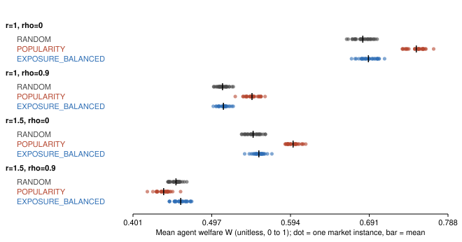
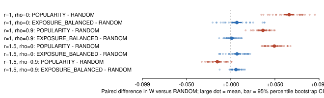
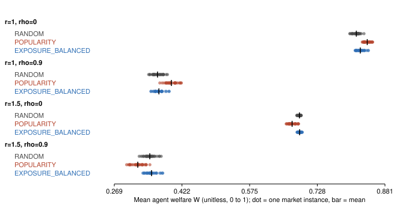
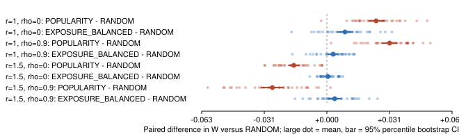
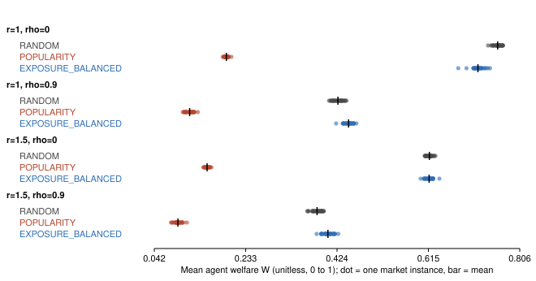
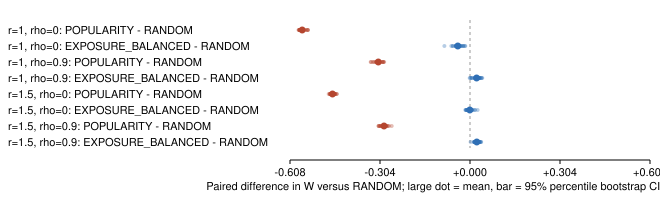
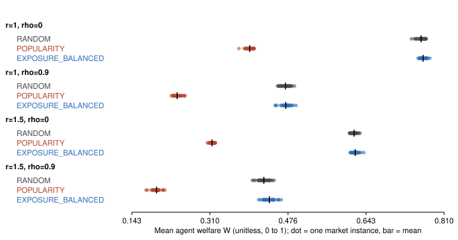
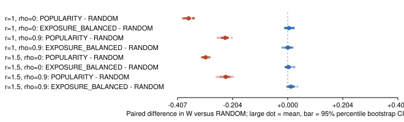

<!-- SPDX-License-Identifier: LicenseRef-MATCH-NC-Research-1.0 -->
# MATCH run report

Generated by `python -m match_lab report` from validated result files. All participants are synthetic.

Arm abbreviations in tables: RND = RANDOM, POP = POPULARITY, EXB = EXPOSURE_BALANCED; DA_A, DA_B and MAXW as in the protocol.

## EXP-003 (confirmatory): EXP-003 sensitivity S1 (theta 0.3, 0.7 at T = 40) and S2 (T 10, 20) (FROZEN v1.0, owner-approved 2026-11-24; same root seed as EXP-001)

- Result file: `results/confirmatory/EXP-003/results.json`
- Config SHA-256: `91669781cf730391a79dcc6a36e3317a5c7f83202c2a603c3e393d563bc37489`
- Code revision: `cfc90d0dfa9aa9058ee780a8d8fe3abdc77343d3`; generator: GEN-match-market v1
- Root seed: 20261124; n_A = 200; r in [1.0, 1.5]; rho in [0.0, 0.9]; 30 instances per cell; settings: S1-theta0.3 (theta 0.3, T 40), S1-theta0.7 (theta 0.7, T 40), S2-T10 (theta 0.5, T 10), S2-T20 (theta 0.5, T 20)
- Runs: 1440; total runtime of runs 306.19 s

### Arm summary (mean and SD over instances)

| setting | r, rho | arm | n | W | SD(W) | U | M | Gini exp. B | block/100 | runtime s |
|---|---|---|---|---|---|---|---|---|---|---|
| S1-theta0.3 | 1, 0 | RND | 30 | 0.6833 | 0.0101 | 0.0062 | 0.5724 | 0.2438 | 987.0583 | 0.1374 |
| S1-theta0.3 | 1, 0 | POP | 30 | 0.7490 | 0.0101 | 0.0052 | 0.6486 | 0.3214 | 615.7083 | 0.3311 |
| S1-theta0.3 | 1, 0 | EXB | 30 | 0.6902 | 0.0100 | 0.0055 | 0.5795 | 0.2888 | 942.3417 | 0.1487 |
| S1-theta0.3 | 1, 0.9 | RND | 30 | 0.5107 | 0.0061 | 0.1748 | 0.5074 | 0.3628 | 1303.7167 | 0.1615 |
| S1-theta0.3 | 1, 0.9 | POP | 30 | 0.5470 | 0.0081 | 0.1490 | 0.5558 | 0.2398 | 782.9500 | 0.3090 |
| S1-theta0.3 | 1, 0.9 | EXB | 30 | 0.5118 | 0.0057 | 0.1822 | 0.5195 | 0.3037 | 1208.4750 | 0.1681 |
| S1-theta0.3 | 1.5, 0 | RND | 30 | 0.5483 | 0.0083 | 0.2000 | 0.5717 | 0.1970 | 1670.4067 | 0.1951 |
| S1-theta0.3 | 1.5, 0 | POP | 30 | 0.5975 | 0.0070 | 0.2049 | 0.6464 | 0.5477 | 1208.0267 | 0.4050 |
| S1-theta0.3 | 1.5, 0 | EXB | 30 | 0.5554 | 0.0067 | 0.2000 | 0.5783 | 0.3619 | 1594.0733 | 0.2277 |
| S1-theta0.3 | 1.5, 0.9 | RND | 30 | 0.4534 | 0.0060 | 0.2769 | 0.5068 | 0.3231 | 1786.3867 | 0.1963 |
| S1-theta0.3 | 1.5, 0.9 | POP | 30 | 0.4383 | 0.0081 | 0.3203 | 0.5565 | 0.4937 | 1568.4200 | 0.3720 |
| S1-theta0.3 | 1.5, 0.9 | EXB | 30 | 0.4593 | 0.0079 | 0.2784 | 0.5191 | 0.2839 | 1621.9667 | 0.2109 |
| S1-theta0.7 | 1, 0 | RND | 30 | 0.8166 | 0.0075 | 0.0493 | 0.8084 | 0.2385 | 210.8333 | 0.2041 |
| S1-theta0.7 | 1, 0 | POP | 30 | 0.8412 | 0.0070 | 0.0365 | 0.8243 | 0.3017 | 168.0833 | 0.3129 |
| S1-theta0.7 | 1, 0 | EXB | 30 | 0.8257 | 0.0083 | 0.0420 | 0.8124 | 0.2909 | 200.7250 | 0.2247 |
| S1-theta0.7 | 1, 0.9 | RND | 30 | 0.3667 | 0.0113 | 0.5563 | 0.7799 | 0.2832 | 277.5417 | 0.2733 |
| S1-theta0.7 | 1, 0.9 | POP | 30 | 0.3981 | 0.0126 | 0.5240 | 0.7920 | 0.1022 | 220.0250 | 0.3775 |
| S1-theta0.7 | 1, 0.9 | EXB | 30 | 0.3699 | 0.0107 | 0.5545 | 0.7839 | 0.2642 | 266.2417 | 0.2892 |
| S1-theta0.7 | 1.5, 0 | RND | 30 | 0.6878 | 0.0029 | 0.2001 | 0.8106 | 0.1800 | 317.4733 | 0.2666 |
| S1-theta0.7 | 1.5, 0 | POP | 30 | 0.6713 | 0.0082 | 0.2309 | 0.8236 | 0.5330 | 297.4600 | 0.4584 |
| S1-theta0.7 | 1.5, 0 | EXB | 30 | 0.6883 | 0.0033 | 0.2000 | 0.8107 | 0.3397 | 316.2600 | 0.3026 |
| S1-theta0.7 | 1.5, 0.9 | RND | 30 | 0.3492 | 0.0122 | 0.5772 | 0.7785 | 0.2529 | 346.3800 | 0.3422 |
| S1-theta0.7 | 1.5, 0.9 | POP | 30 | 0.3219 | 0.0136 | 0.6151 | 0.7924 | 0.4031 | 366.9933 | 0.4253 |
| S1-theta0.7 | 1.5, 0.9 | EXB | 30 | 0.3531 | 0.0121 | 0.5745 | 0.7821 | 0.2533 | 337.4333 | 0.3416 |
| S2-T10 | 1, 0 | RND | 30 | 0.7601 | 0.0080 | 0.0152 | 0.6901 | 0.2420 | 532.0250 | 0.0882 |
| S2-T10 | 1, 0 | POP | 30 | 0.1930 | 0.0038 | 0.7615 | 0.7281 | 0.7611 | 1818.5167 | 0.1077 |
| S2-T10 | 1, 0 | EXB | 30 | 0.7189 | 0.0128 | 0.0715 | 0.6918 | 0.2982 | 596.4417 | 0.0978 |
| S2-T10 | 1, 0.9 | RND | 30 | 0.4263 | 0.0101 | 0.4177 | 0.6524 | 0.2672 | 728.7917 | 0.0989 |
| S2-T10 | 1, 0.9 | POP | 30 | 0.1163 | 0.0077 | 0.8452 | 0.6824 | 0.7568 | 1898.9250 | 0.1195 |
| S2-T10 | 1, 0.9 | EXB | 30 | 0.4484 | 0.0090 | 0.3847 | 0.6484 | 0.2760 | 702.1583 | 0.0924 |
| S2-T10 | 1.5, 0 | RND | 30 | 0.6173 | 0.0060 | 0.2000 | 0.6889 | 0.1900 | 870.3533 | 0.1304 |
| S2-T10 | 1.5, 0 | POP | 30 | 0.1528 | 0.0037 | 0.8107 | 0.7290 | 0.8407 | 2316.5933 | 0.1495 |
| S2-T10 | 1.5, 0 | EXB | 30 | 0.6168 | 0.0079 | 0.2037 | 0.6924 | 0.3213 | 853.7867 | 0.1422 |
| S2-T10 | 1.5, 0.9 | RND | 30 | 0.3826 | 0.0097 | 0.4773 | 0.6484 | 0.2143 | 986.6467 | 0.1248 |
| S2-T10 | 1.5, 0.9 | POP | 30 | 0.0919 | 0.0071 | 0.8779 | 0.6847 | 0.8379 | 2395.8000 | 0.1199 |
| S2-T10 | 1.5, 0.9 | EXB | 30 | 0.4054 | 0.0106 | 0.4463 | 0.6488 | 0.3147 | 927.4200 | 0.1111 |
| S2-T20 | 1, 0 | RND | 30 | 0.7605 | 0.0079 | 0.0147 | 0.6901 | 0.2420 | 531.4333 | 0.1140 |
| S2-T20 | 1, 0 | POP | 30 | 0.3946 | 0.0074 | 0.5113 | 0.7285 | 0.5532 | 1223.2500 | 0.2370 |
| S2-T20 | 1, 0 | EXB | 30 | 0.7649 | 0.0063 | 0.0133 | 0.6932 | 0.2869 | 516.7750 | 0.1356 |
| S2-T20 | 1, 0.9 | RND | 30 | 0.4709 | 0.0097 | 0.3442 | 0.6413 | 0.3775 | 699.7417 | 0.1427 |
| S2-T20 | 1, 0.9 | POP | 30 | 0.2397 | 0.0080 | 0.6765 | 0.6744 | 0.5320 | 1381.8250 | 0.2057 |
| S2-T20 | 1, 0.9 | EXB | 30 | 0.4716 | 0.0104 | 0.3462 | 0.6427 | 0.3352 | 690.2917 | 0.1599 |
| S2-T20 | 1.5, 0 | RND | 30 | 0.6173 | 0.0060 | 0.2000 | 0.6889 | 0.1900 | 870.3533 | 0.1440 |
| S2-T20 | 1.5, 0 | POP | 30 | 0.3141 | 0.0044 | 0.6103 | 0.7283 | 0.7021 | 1686.9400 | 0.2603 |
| S2-T20 | 1.5, 0 | EXB | 30 | 0.6199 | 0.0066 | 0.2000 | 0.6928 | 0.3217 | 844.5000 | 0.1609 |
| S2-T20 | 1.5, 0.9 | RND | 30 | 0.4247 | 0.0116 | 0.4105 | 0.6373 | 0.2861 | 958.8133 | 0.1630 |
| S2-T20 | 1.5, 0.9 | POP | 30 | 0.1955 | 0.0090 | 0.7361 | 0.6731 | 0.6884 | 1847.4000 | 0.2421 |
| S2-T20 | 1.5, 0.9 | EXB | 30 | 0.4366 | 0.0123 | 0.3959 | 0.6400 | 0.3553 | 914.0133 | 0.1776 |

### Paired differences in W versus RANDOM, per cell

Mean, SD and dz of per-instance paired differences; 95% percentile bootstrap CI over instances (10,000 resamples). `N(SESOI)` is the normal-approximation number of instances per cell for 80% power to detect a difference of 0.01 in that cell, using this run's SD (planning only).

| setting | r, rho | contrast | n | mean D | SD(D) | dz | CI lo | CI hi | N(SESOI) |
|---|---|---|---|---|---|---|---|---|---|
| S1-theta0.3 | 1, 0 | POP - RND | 30 | 0.0657 | 0.0156 | 4.2261 | 0.0603 | 0.0711 | 19 |
| S1-theta0.3 | 1, 0 | EXB - RND | 30 | 0.0069 | 0.0153 | 0.4512 | 0.0015 | 0.0124 | 19 |
| S1-theta0.3 | 1, 0.9 | POP - RND | 30 | 0.0362 | 0.0078 | 4.6177 | 0.0334 | 0.0389 | 5 |
| S1-theta0.3 | 1, 0.9 | EXB - RND | 30 | 0.0011 | 0.0065 | 0.1718 | -0.0012 | 0.0034 | 4 |
| S1-theta0.3 | 1.5, 0 | POP - RND | 30 | 0.0492 | 0.0098 | 5.0354 | 0.0457 | 0.0526 | 8 |
| S1-theta0.3 | 1.5, 0 | EXB - RND | 30 | 0.0071 | 0.0105 | 0.6738 | 0.0033 | 0.0105 | 9 |
| S1-theta0.3 | 1.5, 0.9 | POP - RND | 30 | -0.0151 | 0.0091 | -1.6565 | -0.0183 | -0.0118 | 7 |
| S1-theta0.3 | 1.5, 0.9 | EXB - RND | 30 | 0.0059 | 0.0060 | 0.9878 | 0.0037 | 0.0079 | 3 |
| S1-theta0.7 | 1, 0 | POP - RND | 30 | 0.0246 | 0.0113 | 2.1844 | 0.0206 | 0.0285 | 10 |
| S1-theta0.7 | 1, 0 | EXB - RND | 30 | 0.0090 | 0.0115 | 0.7837 | 0.0050 | 0.0131 | 11 |
| S1-theta0.7 | 1, 0.9 | POP - RND | 30 | 0.0313 | 0.0115 | 2.7176 | 0.0273 | 0.0352 | 11 |
| S1-theta0.7 | 1, 0.9 | EXB - RND | 30 | 0.0031 | 0.0076 | 0.4126 | 0.0004 | 0.0057 | 5 |
| S1-theta0.7 | 1.5, 0 | POP - RND | 30 | -0.0165 | 0.0083 | -1.9997 | -0.0193 | -0.0135 | 6 |
| S1-theta0.7 | 1.5, 0 | EXB - RND | 30 | 0.0005 | 0.0041 | 0.1163 | -0.0010 | 0.0019 | 2 |
| S1-theta0.7 | 1.5, 0.9 | POP - RND | 30 | -0.0272 | 0.0160 | -1.6980 | -0.0329 | -0.0216 | 21 |
| S1-theta0.7 | 1.5, 0.9 | EXB - RND | 30 | 0.0039 | 0.0096 | 0.4075 | 0.0006 | 0.0073 | 8 |
| S2-T10 | 1, 0 | POP - RND | 30 | -0.5671 | 0.0092 | -61.4808 | -0.5702 | -0.5637 | 7 |
| S2-T10 | 1, 0 | EXB - RND | 30 | -0.0412 | 0.0144 | -2.8647 | -0.0464 | -0.0362 | 17 |
| S2-T10 | 1, 0.9 | POP - RND | 30 | -0.3100 | 0.0115 | -27.0170 | -0.3140 | -0.3060 | 11 |
| S2-T10 | 1, 0.9 | EXB - RND | 30 | 0.0222 | 0.0114 | 1.9471 | 0.0180 | 0.0261 | 11 |
| S2-T10 | 1.5, 0 | POP - RND | 30 | -0.4645 | 0.0072 | -64.3170 | -0.4670 | -0.4620 | 5 |
| S2-T10 | 1.5, 0 | EXB - RND | 30 | -0.0006 | 0.0097 | -0.0578 | -0.0039 | 0.0029 | 8 |
| S2-T10 | 1.5, 0.9 | POP - RND | 30 | -0.2907 | 0.0105 | -27.6269 | -0.2944 | -0.2870 | 9 |
| S2-T10 | 1.5, 0.9 | EXB - RND | 30 | 0.0228 | 0.0085 | 2.6923 | 0.0198 | 0.0259 | 6 |
| S2-T20 | 1, 0 | POP - RND | 30 | -0.3659 | 0.0118 | -30.9514 | -0.3701 | -0.3618 | 11 |
| S2-T20 | 1, 0 | EXB - RND | 30 | 0.0045 | 0.0107 | 0.4186 | 0.0008 | 0.0083 | 9 |
| S2-T20 | 1, 0.9 | POP - RND | 30 | -0.2312 | 0.0106 | -21.8886 | -0.2351 | -0.2276 | 9 |
| S2-T20 | 1, 0.9 | EXB - RND | 30 | 0.0007 | 0.0095 | 0.0709 | -0.0027 | 0.0040 | 8 |
| S2-T20 | 1.5, 0 | POP - RND | 30 | -0.3032 | 0.0073 | -41.3143 | -0.3058 | -0.3006 | 5 |
| S2-T20 | 1.5, 0 | EXB - RND | 30 | 0.0026 | 0.0084 | 0.3127 | -0.0002 | 0.0057 | 6 |
| S2-T20 | 1.5, 0.9 | POP - RND | 30 | -0.2292 | 0.0129 | -17.7036 | -0.2339 | -0.2247 | 14 |
| S2-T20 | 1.5, 0.9 | EXB - RND | 30 | 0.0119 | 0.0086 | 1.3784 | 0.0089 | 0.0151 | 6 |

### Equal-weight mean over cells (theta) of W differences versus RANDOM

Stratified bootstrap CIs. `N/cell pooled` is the instances per cell needed for 80% power on the pooled contrast at effect 0.01, from this run's per-cell SDs (planning only). No p-values: protocol section 8 limits tests to the EXP-001 family.

| setting | arm | cells | theta | 95% lo | 95% hi | 90% lo | 90% hi | N/cell pooled | p | p Holm |
|---|---|---|---|---|---|---|---|---|---|---|
| S1-theta0.3 | EXB | 4 | 0.0052 | 0.0035 | 0.0071 | 0.0037 | 0.0068 | 3 | n/a | n/a |
| S1-theta0.3 | POP | 4 | 0.0340 | 0.0321 | 0.0359 | 0.0324 | 0.0356 | 3 | n/a | n/a |
| S1-theta0.7 | EXB | 4 | 0.0041 | 0.0026 | 0.0056 | 0.0029 | 0.0054 | 2 | n/a | n/a |
| S1-theta0.7 | POP | 4 | 0.0030 | 0.0009 | 0.0052 | 0.0013 | 0.0048 | 3 | n/a | n/a |
| S2-T10 | EXB | 4 | 0.0008 | -0.0012 | 0.0027 | -0.0008 | 0.0024 | 3 | n/a | n/a |
| S2-T10 | POP | 4 | -0.4081 | -0.4098 | -0.4064 | -0.4095 | -0.4066 | 2 | n/a | n/a |
| S2-T20 | EXB | 4 | 0.0049 | 0.0033 | 0.0066 | 0.0036 | 0.0063 | 2 | n/a | n/a |
| S2-T20 | POP | 4 | -0.2824 | -0.2843 | -0.2805 | -0.2840 | -0.2808 | 3 | n/a | n/a |

### Degenerate-case checks

- Invalid runs: 0 of 1440; excluded instances: 0.
- S1-theta0.3 r=1, rho=0 EXPOSURE_BALANCED: 0.0% of slates shortened by the exposure cap.
- S1-theta0.3 r=1, rho=0.9 EXPOSURE_BALANCED: 0.6% of slates shortened by the exposure cap.
- S1-theta0.3 r=1.5, rho=0 EXPOSURE_BALANCED: 0.0% of slates shortened by the exposure cap.
- S1-theta0.3 r=1.5, rho=0.9 EXPOSURE_BALANCED: 0.6% of slates shortened by the exposure cap.
- S1-theta0.7 r=1, rho=0 EXPOSURE_BALANCED: 0.2% of slates shortened by the exposure cap.
- S1-theta0.7 r=1, rho=0.9 EXPOSURE_BALANCED: 1.0% of slates shortened by the exposure cap.
- S1-theta0.7 r=1.5, rho=0 EXPOSURE_BALANCED: 0.1% of slates shortened by the exposure cap.
- S1-theta0.7 r=1.5, rho=0.9 EXPOSURE_BALANCED: 0.7% of slates shortened by the exposure cap.
- S2-T10 r=1.5, rho=0 EXPOSURE_BALANCED: 0.0% of slates shortened by the exposure cap.
- S2-T20 r=1, rho=0 EXPOSURE_BALANCED: 0.0% of slates shortened by the exposure cap.
- S2-T20 r=1, rho=0.9 EXPOSURE_BALANCED: 1.6% of slates shortened by the exposure cap.
- S2-T20 r=1.5, rho=0 EXPOSURE_BALANCED: 0.0% of slates shortened by the exposure cap.
- S2-T20 r=1.5, rho=0.9 EXPOSURE_BALANCED: 0.8% of slates shortened by the exposure cap.

{width=80%}

{width=80%}

{width=80%}

{width=80%}

{width=80%}

{width=80%}

{width=80%}

{width=80%}

## Projected runtime of the planned matrix (single process)

Projection from the measured mean runtime per (n_A, r, rho, theta, T, arm), plus market generation. Runs without an exact measurement are scaled linearly in T (sequential arms) or reused (centralized arms); the count of such runs is shown.

| experiment | planned runs | projected s | runs scaled | runs unmeasured |
|---|---|---|---|---|
| EXP-001 | 810 | 125.3 | 360 | 450 |
| EXP-002 | 810 | 1.5 | 0 | 810 |
| EXP-003 | 1440 | 312.3 | 0 | 0 |

