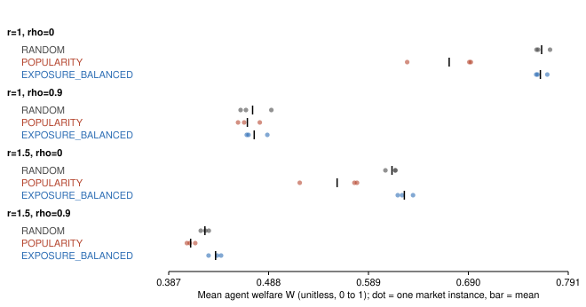
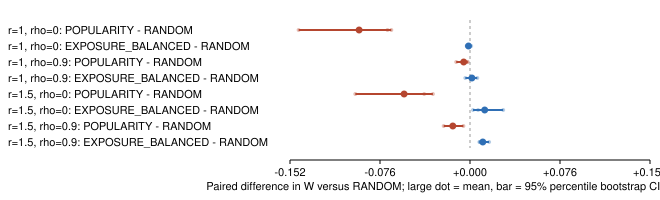

<!-- SPDX-License-Identifier: LicenseRef-MATCH-NC-Research-1.0 -->
# MATCH exploratory run report

**EXPLORATORY. Not a finding.** These are synthetic simulation results from an exploratory run made before the protocol freeze. They exist to check the pipeline and to measure runtime, seed spread and degenerate cases for the owner's freeze decision. They test no hypothesis, carry no p-values and must not be cited as evidence.

Generated by `python -m match_lab report` from validated result files. All participants are synthetic.

Arm abbreviations in tables: RND = RANDOM, POP = POPULARITY, EXB = EXPOSURE_BALANCED; DA_A, DA_B and MAXW as in the protocol.

## PROBE-TIE (exploratory): Exploratory probe of the popularity tie-key granularity (per-viewer keys, D-007 alternative), corner cells, 3 instances; not a finding

- Result file: `results/exploratory/probe_tie_scope/results.json`
- Config SHA-256: `f6dc7a3d3fcb30c7d784cc3106e461ac795bcaaa224c1a5acbe83eea54ff5c87`
- Code revision: `d42019e5e47ec150f4d144fb9ec7269479470e02`; generator: GEN-match-market v1
- Root seed: 404; n_A = 200; r in [1.0, 1.5]; rho in [0.0, 0.9]; 3 instances per cell; settings: base (theta 0.5, T 20)
- Runs: 36; total runtime of runs 8.30 s

### Arm summary (mean and SD over instances)

| setting | r, rho | arm | n | W | SD(W) | U | M | Gini exp. B | block/100 | runtime s |
|---|---|---|---|---|---|---|---|---|---|---|
| base | 1, 0 | RND | 3 | 0.7637 | 0.0075 | 0.0133 | 0.6923 | 0.2424 | 521.9167 | 0.0453 |
| base | 1, 0 | POP | 3 | 0.6703 | 0.0367 | 0.1617 | 0.7182 | 0.4997 | 617.7500 | 0.0888 |
| base | 1, 0 | EXB | 3 | 0.7625 | 0.0061 | 0.0200 | 0.6959 | 0.2965 | 506.3333 | 0.0533 |
| base | 1, 0.9 | RND | 3 | 0.4716 | 0.0166 | 0.3467 | 0.6443 | 0.3785 | 712.7500 | 0.0645 |
| base | 1, 0.9 | POP | 3 | 0.4663 | 0.0113 | 0.3817 | 0.6963 | 0.4657 | 336.0000 | 0.0938 |
| base | 1, 0.9 | EXB | 3 | 0.4732 | 0.0115 | 0.3467 | 0.6460 | 0.3267 | 706.1667 | 0.0696 |
| base | 1.5, 0 | RND | 3 | 0.6125 | 0.0058 | 0.2000 | 0.6825 | 0.1894 | 898.8000 | 0.0711 |
| base | 1.5, 0 | POP | 3 | 0.5570 | 0.0327 | 0.3053 | 0.7214 | 0.6278 | 910.5333 | 0.1420 |
| base | 1.5, 0 | EXB | 3 | 0.6250 | 0.0080 | 0.2000 | 0.7025 | 0.3553 | 824.9333 | 0.1122 |
| base | 1.5, 0.9 | RND | 3 | 0.4234 | 0.0041 | 0.4093 | 0.6358 | 0.2873 | 1001.5333 | 0.7418 |
| base | 1.5, 0.9 | POP | 3 | 0.4090 | 0.0043 | 0.4733 | 0.7113 | 0.6574 | 405.5333 | 0.9904 |
| base | 1.5, 0.9 | EXB | 3 | 0.4342 | 0.0065 | 0.4000 | 0.6370 | 0.3626 | 935.6000 | 0.2929 |

### Paired differences in W versus RANDOM, per cell

Mean, SD and dz of per-instance paired differences; 95% percentile bootstrap CI over instances (10,000 resamples). `N(SESOI)` is the normal-approximation number of instances per cell for 80% power to detect a difference of 0.01 in that cell, using this run's SD (planning only).

| setting | r, rho | contrast | n | mean D | SD(D) | dz | CI lo | CI hi | N(SESOI) |
|---|---|---|---|---|---|---|---|---|---|
| base | 1, 0 | POP - RND | 3 | -0.0935 | 0.0442 | -2.1143 | -0.1445 | -0.0663 | 154 |
| base | 1, 0 | EXB - RND | 3 | -0.0013 | 0.0020 | -0.6323 | -0.0028 | 0.0010 | 1 |
| base | 1, 0.9 | POP - RND | 3 | -0.0053 | 0.0054 | -0.9831 | -0.0116 | -0.0018 | 3 |
| base | 1, 0.9 | EXB - RND | 3 | 0.0016 | 0.0052 | 0.3120 | -0.0040 | 0.0062 | 3 |
| base | 1.5, 0 | POP - RND | 3 | -0.0555 | 0.0358 | -1.5494 | -0.0967 | -0.0313 | 101 |
| base | 1.5, 0 | EXB - RND | 3 | 0.0124 | 0.0136 | 0.9134 | 0.0025 | 0.0279 | 15 |
| base | 1.5, 0.9 | POP - RND | 3 | -0.0145 | 0.0084 | -1.7251 | -0.0222 | -0.0055 | 6 |
| base | 1.5, 0.9 | EXB - RND | 3 | 0.0108 | 0.0046 | 2.3528 | 0.0079 | 0.0161 | 2 |

### Equal-weight mean over cells (theta) of W differences versus RANDOM

Stratified bootstrap CIs. `N/cell pooled` is the instances per cell needed for 80% power on the pooled contrast at effect 0.01, from this run's per-cell SDs (planning only). No p-values are computed for exploratory runs.

| setting | arm | cells | theta | 95% lo | 95% hi | 90% lo | 90% hi | N/cell pooled | p | p Holm |
|---|---|---|---|---|---|---|---|---|---|---|
| base | EXB | 4 | 0.0059 | 0.0027 | 0.0096 | 0.0031 | 0.0090 | 2 | n/a | n/a |
| base | POP | 4 | -0.0422 | -0.0555 | -0.0299 | -0.0541 | -0.0310 | 17 | n/a | n/a |

### Degenerate-case checks

- Invalid runs: 0 of 36; excluded instances: 0.
- base r=1, rho=0 EXPOSURE_BALANCED: 0.0% of slates shortened by the exposure cap.
- base r=1, rho=0.9 EXPOSURE_BALANCED: 1.5% of slates shortened by the exposure cap.
- base r=1.5, rho=0 EXPOSURE_BALANCED: 0.0% of slates shortened by the exposure cap.
- base r=1.5, rho=0.9 EXPOSURE_BALANCED: 0.8% of slates shortened by the exposure cap.

{width=80%}

{width=80%}
